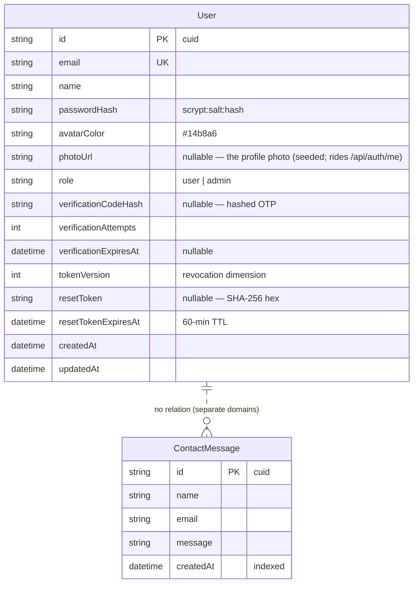

# ViralPost AI — Master Project Architecture Document (PAD) v2.0

**Classification:** Internal Engineering Reference
**Status:** DEFINITIVE, PRODUCTION-LOCKED BLUEPRINT
**Companion Document:** `README.md` (onboarding), `AGENTS.md` (operator quick-reference), `CLAUDE.md` (agent contract), `viralpost-ai_SKILL.md` (distilled memory)
**Last Updated:** 2026-11-18 (session-85 ship — the S85-1 date re-anchor)
**Audience:** Senior Engineers, Tech Leads, DevOps, and Onboarding Engineers
**Rule:** Every architectural decision in this document traces to a specific rationale.
Nothing is here "because it's popular."

---

## Table of Contents

1. [System Overview & Decisions](#1-system-overview--decisions)
2. [High-Level System Topology](#2-high-level-system-topology)
3. [Application Architecture](#3-application-architecture)
4. [Data Architecture](#4-data-architecture)
5. [Design System Reference](#5-design-system-reference)
6. [Security Architecture](#6-security-architecture)
8. [Testing Strategy](#8-testing-strategy)
9. [Build & Deployment](#9-build--deployment)
10. [Developer Handbook](#10-developer-handbook)
11. [Known Issues & Outstanding Tasks](#11-known-issues--outstanding-tasks)
12. [Key Files Reference](#12-key-files-reference)
13. [Glossary](#13-glossary)

(The ladder skips §7 — a session-1 renumbering left the gap; the heading
numbers are the citation currency (the "§12" pins), so the gap is kept
rather than renumbering every reference. Session-21, S21-14.)

---

## 1. System Overview & Decisions

### 1.1 Document Metadata & Purpose

ViralPost AI is a self-hostable clone of
`https://viralpostai.base44.app/` — an AI social media post generator —
built as a **functional superset with visual parity**. This PAD is the
single source of truth for how the clone is put together and why. New
engineers: read §1, §3, §10. Debugging: start at §11 and the skill's
symptom table. Reviewing tech choices: the ADRs below.

The repo was previously the NEO-CRM clone (the "template family"); the
session-1 build replaced the CRM domain with ViralPost AI's while keeping
the battle-tested infrastructure seams (auth, db-path, rate limiting,
the gate). git history carries the CRM lineage.

### 1.2 Technology Stack Summary

| Layer | Technology | Version | Key Rationale |
|---|---|---|---|
| Web framework | Next.js (App Router) | 16.4.6 | The template's standing stack; SSR metadata + route handlers is the SEO/robustness superset over the reference's SPA. 16.4.6 since session-79 (the S79-1 GHSA-mfr8-8qww-v76h patch bump; 16.4.2 at sessions 1–78) |
| UI runtime | React | 19.3.1 | Ships with Next 16; client islands only where interactivity demands |
| Language | TypeScript | 5.9.3 (strict) | The build is the type gate (`ignoreBuildErrors` never set) |
| Styling | Tailwind CSS | 4.3.3 (CSS-first) | The reference is Tailwind-classed; the template's v4 doctrine (literal hex `@theme`, `@custom-variant hover`) is carried and test-pinned |
| PostCSS | @tailwindcss/postcss | ^4 | The only plugin |
| ORM | Prisma | 6.19.3 | The template's seam-tested data layer |
| Database | SQLite (dev) | — | `db/custom.db` at the repo root; PostgreSQL swap documented in `.env.example` |
| Validation | Zod | 4.6.7 | Every API boundary |
| Icons | lucide-react | 0.525.0 | The reference's own icon family (bundle-decoded) |
| Unit tests | Vitest | 5.0.5 | Node env, `@` alias, `*.test.ts` only |
| E2E | @playwright/test | 1.64.1 | Against the production standalone build |
| A11y | axe-core | 4.x | Assertions inside the e2e suite |
| Runtime | Bun | 1.3.14 | Scripts run from the repo root |

**Dependency diet (session 2; surface re-anchored session 19):** the
CRM-era packages the new domain never imported were removed — `zustand`,
`recharts`, `jspdf`, `html2canvas-pro`, `class-variance-authority`, and
six `@radix-ui/*` primitives. The runtime dependency surface is exactly
EIGHT packages: `@prisma/client`, `clsx`, `lucide-react`, `next`,
`react`, `react-dom`, `tailwind-merge`, `zod` — plus the `prisma` CLI as
a devDependency since session-15 (S15-3; build-time tooling, never in
the standalone artifact). The toast is a from-scratch subscribe/store
hook that mirrors the Radix toast API shape; the
reveal/particle/WebGL/floating-icons effects are dependency-free.

### 1.3 Architecture Decision Records

**ADR-001: Keep the template's Next.js 16 standalone stack (do not re-scaffold as an SPA)**

- **Context:** The reference is a Vite-style React SPA on the Base44
  platform. A clone could mirror that shape exactly.
- **Decision:** Keep Next.js 16 App Router with `output: "standalone"`,
  ported from the NEO-CRM template.
- **Rationale:** SSR/SSG metadata, real route handlers, and true HTTP
  statuses are precisely the capabilities the reference's SPA lacks —
  they ARE the superset. The template's seams (db-path, auth, rate limit)
  carry 200+ sessions of hardening.
- **Consequences:** Server/client component discipline required; the
  unknown-route 404 needed a catch-all architecture (ADR-006). Positive:
  SEO, testability, one deployable artifact.
- **Alternatives rejected:** A Vite SPA clone (would replicate the
  reference's 200-everywhere and client-only metadata); keeping the CRM
  domain (wrong product).

**ADR-002: The generator is a deterministic local engine, not an LLM call**

- **Context:** The reference's generator calls its platform LLM
  (`InvokeLLM`), which was observed returning **HTTP 402** (quota
  exhausted) with the UI hanging at "Generating…" forever — logged out
  AND logged in (docs/reference-investigation.md §5 D-1).
- **Decision:** `src/lib/generator.ts` is a pure function
  `generatePost(idea, seed)` implementing the reference's own prompt
  rules (hook first line, 1-2 sentence paragraphs, emotional tone, 5-8
  hashtags, < 200 words, no labels) with niche banks (fitness, business,
  lifestyle, fashion, food, travel, motivation, tech + evergreen
  fallback). The API route passes a crypto-random seed. The reference's
  exact prompt is preserved in `generatorPrompt()` for a future
  provider face.
- **Rationale:** The core feature must actually work, offline, with zero
  keys. Determinism makes the contract property-testable.
- **Consequences:** Posts are formula-driven, not model-generated; an
  optional OpenAI-compatible provider can be wired behind env without
  touching the contract.
- **Alternatives rejected:** Calling a real LLM by default (needs keys,
  non-deterministic, untestable offline); shipping the 402 hang (a
  regression, not a clone).

**ADR-003: Free quota = the reference's client counter + a server rate limit**

- **Context:** The reference tracks generations in
  `localStorage["viralpost_generations"]` (3/day, daily reset) —
  client-trustworthy only.
- **Decision:** Replicate the counter verbatim (`src/lib/generation-counter.ts`
  — pure functions + a `useSyncExternalStore` adapter) for the UX, and add
  an IP-keyed server rate limit on `/api/generate` (20 / 15 min) for the
  wall.
- **Rationale:** Same visible behavior as the reference; the API can't be
  scripted around the client wall.
- **Consequences:** A logged-out user who clears storage sees the quota
  refresh — same as the reference. The limiter is in-process (single-node
  posture, §6).
- **Alternatives rejected:** Server-side quota with a Generation row
  (needs auth for the core flow — the reference allows logged-out
  generation); no limiter (abuse-open).

**ADR-004: httpOnly HMAC cookie sessions (not the reference's localStorage token)**

- **Context:** The reference stores its token in localStorage —
  XSS-readable, no revocation.
- **Decision:** Port the template's auth family wholesale: scrypt
  password hashes (per-user salt, constant-time compare, timing
  equalizer), HMAC-SHA256-signed stateless cookies
  (`base64url({uid,iat,exp,v}) + "." + hex_sig`, httpOnly, lax,
  secure-in-prod, 7-day TTL), the `tokenVersion` revocation dimension
  (password reset kills every prior cookie), hashed-at-rest single-use
  reset tokens, no-enumeration forgot-password, per-IP rate limits.
- **Rationale:** Security hardening is the documented superset doctrine;
  the seam is the template's most valuable inheritance.
- **Consequences:** More moving parts than a token in localStorage; all
  battle-tested and pinned by the unit suite (the auth-family checks
  inside the unit gate — 599 tests at the session-22 ship, live-pinned by
  the docs-counts census).
- **Alternatives rejected:** Mirroring localStorage auth (a downgrade);
  NextAuth/JWT libraries (more dependencies, less control).

**ADR-005: Tailwind v4 CSS-first with the template's trap mitigations**

- **Context:** Tailwind v4 has known traps (bare HSL triplets in `@theme`
  resolve to transparent; the default oklch palette drifts; `hover:`
  sticks on touch devices).
- **Decision:** Tokens in `globals.css` `@theme` with literal hex;
  the `@custom-variant hover` unwrap; the design-tokens and typography
  test suites pin the theme textually. (Session-11, F11-2: the vendored
  animate-utilities file that originally rode this ADR was RETIRED — it
  shipped dead keyframes on a phantom Radix claim; the step-less color
  census + the dead-token census in `tests/design-tokens.test.ts` are
  the guard rails.)
- **Rationale:** The reference is Tailwind-classed (`bg-slate-900`,
  `from-teal-500`…); class-for-class parity requires the same engine
  without v4's foot-guns.
- **Consequences:** No `tailwind.config.js` ever; token changes update
  the pinning tests in the same commit.
- **Alternatives rejected:** v3 config style (fights v4's engine);
  CSS-in-JS (wrong engine entirely).

**ADR-006: The unknown-route 404 — title in the catch-all LAYOUT, notFound() in the page**

- **Context:** The reference (an SPA) titles unknown routes
  `<StartCase(last segment)> | ViralPost AI` (`/Dashboard` →
  "Dashboard | ViralPost AI") and answers HTTP 200. *(Session-45
  re-verification: the reference's derivation STOPPED REPRODUCING —
  bare title on every probed unknown route; ours keeps the derived
  form as the documented superset, the Deviations Ledger row.)*
  Next's not-found
  boundary cannot read the unmatched path server-side, and a page's
  `generateMetadata` is **discarded** when the page calls `notFound()`
  (probe-verified session 2). A client-side title effect is stomped by
  React's metadata hydration (observed live).
- **Decision:** `src/app/[...catchAll]/` owns unknown routes: the
  segment **layout**'s `generateMetadata` derives the ABSOLUTE title from
  params (`unknownRouteTitle()` — non-alnum runs split, camelCase splits,
  digits never split, upperFirst per word, empty → bare title); the page
  calls `notFound()`; the segment `not-found.tsx` renders the standard
  404 body. Result: derived title in the SSR HTML + true 404 status +
  `noindex` — the title derivation is unit-pinned (13 arms in
  `route-title.test.ts`), and the title + status + noindex ride the e2e
  unknown-route test (session-27, S27-6's meta-robots arm) plus smoke
  leg 06 (session-28, S28-9: the old "verified across 13 unit pins and
  an e2e assertion" sentence overstated the unit layer's reach).
- **Rationale:** Layouts render around not-found boundaries, so their
  metadata survives — the only SSR-correct home for the derivation.
- **Consequences:** The 404 body renders through the client stream (the
  curl HTML carries title/status/noindex, not the body text) — the same
  client-rendered posture as the reference's SPA 404; the rendered-body
  contract is owned by the e2e layer. The root `not-found.tsx` remains
  for in-app `notFound()` calls.
- **Alternatives rejected:** Client-side title effect (stomped — race
  with React metadata); a static root 404 with the bare title (the
  parity gap this ADR closes); a route handler rendering hand-built HTML
  (duplicates the head).

**ADR-007: The contact form persists; the reference's is a stub**

- **Context:** The reference's contact form makes zero network calls on
  submit (client-side stub — investigation §5 D-2).
- **Decision:** `POST /api/contact` → Zod-validated `ContactMessage`
  row in SQLite, "Message Sent!" confirmation.
- **Rationale:** An advertised action must be real.
- **Consequences:** One more model + endpoint; trivial.
- **Alternatives rejected:** Mirroring the stub (a defect, not parity).

**ADR-008: SQLite at the repo root through the db-path seam**

- **Context:** Relative `file:` URLs resolve differently per reader
  (Prisma CLI anchors at the schema; the standalone server chdirs
  before modules load) — the template family's most-bitten contract.
- **Decision:** `DATABASE_URL="file:../db/custom.db"` with `db/` at the
  repo root; `src/lib/db-path.ts` is the only sanctioned runtime
  resolver; npm scripts pin or strip the env; the seed routes through
  the seam.
- **Rationale:** Proven across the template family (the empirical
  natural experiment: the disciplined sibling ran 35/35 smoke under a
  polluted shell, the undisciplined one fell to 12/30).
- **Consequences:** `tsc`/tests never depend on CWD; symptom of a break
  is the documented `Error code 14`.
- **Alternatives rejected:** Absolute paths in dev (breaks the
  clone-and-run story); env-only resolution (the CWD trap).

---

## 2. High-Level System Topology

```
┌─────────────────────────────────────────────────────────────┐
│ Browser                                                     │
│  - Marketing pages (SSR HTML + client islands)              │
│  - Generator card → fetch /api/generate                     │
│  - localStorage: viralpost_generations (3/day UX counter)   │
└──────────────┬──────────────────────────────────────────────┘
               │ HTTPS (cookie: viralpost_session, httpOnly)
┌──────────────▼──────────────────────────────────────────────┐
│ Next.js standalone server (bun .next/standalone/server.js)  │
│                                                             │
│  Pages (RSC):  / · /Tool · /Pricing · /Contact ·            │
│                /login · /signup · /reset-password ·         │
│                /[...catchAll] (404 + derived title)         │
│  Handlers:     /api/generate · /api/contact · /api/health · │
│                /api/auth/{login,logout,me,signup,verify,    │
│                           resend,forgot-password,           │
│                           reset-password}                   │
│  Seams (lib):  generator · generation-counter · auth ·      │
│                password · rate-limit · db-path · site ·     │
│                route-title · api (envelope/reader) ·        │
│                schemas · page-layout · chunk-recovery       │
└──────────────┬──────────────────────────────────────────────┘
               │ Prisma (SQLite)
┌──────────────▼──────────────────────────────────────────────┐
│ db/custom.db  (User · ContactMessage)                       │
└─────────────────────────────────────────────────────────────┘
```

Scaling characteristics: single-node by design (in-process rate limiter,
SQLite). Multi-instance production requires PostgreSQL + `prisma migrate`
+ a shared-store limiter + `VIRALPOST_PROXY_HOPS` — documented in
`docs/DEPLOYMENT.md`.

---

## 3. Application Architecture

### 3.1 The Layer Model

```
Layer 0  prisma/schema.prisma   — User, ContactMessage. The data truth.
Layer 1  src/lib/*              — pure seams. No upward imports; the
                                  most-tested code in the repo.
Layer 2  src/app/api/*          — route handlers. Thin: gate → read →
                                  parse → Prisma → envelope.
Layer 3  src/components/*       — marketing shell, effects, layout
                                  cards, the ui/toast. Client islands
                                  are explicit ("use client").
Layer 4  src/app/*              — pages + layouts. Thin; metadata via
                                  pageMetadata(); the catch-all owns
                                  the 404 contract (ADR-006).
```

The Golden Rule: imports point DOWN only. A component never imports a
route handler; a seam never imports a component.

### 3.2 Annotated Directory Structure

```
viralpost-ai/
├── prisma/schema.prisma        ← User + ContactMessage (SQLite)
├── prisma/seed.ts              ← idempotent demo user (upsert-by-email)
├── db/                         ← custom.db · e2e.db · smoke.db (gitignored)
├── public/                     ← og-image.png · hero-portrait (captures live in docs/screenshots/)
├── src/
│   ├── app/
│   │   ├── (site)/             ← public chrome: layout (Navbar+Footer),
│   │   │                          page.tsx (landing), Tool/, Pricing/, Contact/
│   │   ├── [...catchAll]/      ← ADR-006: layout (title) + not-found (body)
│   │   │                          + page (notFound())
│   │   ├── api/                ← generate · contact · health · auth/*
│   │   ├── login/ signup/ reset-password/
│   │   ├── layout.tsx          ← root: metadata, viewport, Toaster
│   │   ├── not-found.tsx       ← the root 404 boundary (in-app notFound())
│   │   ├── not-found-body.tsx  ← the shared 404 body (client, usePathname)
│   │   ├── error.tsx global-error.tsx   ← error boundaries
│   │   └── globals.css         ← THE theme (Tailwind v4 @theme)
│   ├── components/
│   │   ├── marketing/          ← navbar (mobile menu) · footer · hero ·
│   │   │                          sections (10 landing blocks) ·
│   │   │                          generator-card · contact-form · logo ·
│   │   │                          nav-config (the shared vocabulary)
│   │   ├── effects/            ← iridescence (WebGL) · particle-text
│   │   │                          (canvas) · reveal (IntersectionObserver)
│   │   ├── layout/             ← login-card (5 views: signin/reset/sent/signup/verify) · reset-password-screen
│   │   └── ui/toast.tsx        ← the subscribe/store toast
│   └── lib/                    ← THE seams (see §12 Key Files)
├── tests/                      ← 41 unit suites + e2e/ (9 specs)
├── scripts/                    ← smoke-test.sh · census.ts · prisma-env.ts · e2e-prune.ts · e2e-contact-readback.ts
├── docs/                       ← plans/ · reference-investigation.md ·
│                                  implementation-plan.md · session logs ·
│                                  screenshots/ · DEPLOYMENT.md · the SSH
│                                  wrapper + its runbook
├── skills/                     ← the owner's skill catalog (NOT app code;
│                                  excluded from tsc/eslint/vitest; the
│                                  smoke artifact-hygiene leg asserts the
│                                  build never ships it)
├── AGENTS.md · CLAUDE.md · README.md · worklog.md
├── viralpost-ai_SKILL.md       ← the distilled engineering memory
└── Project_Architecture_Document.md   ← this file
```

### 3.3 Critical Code Patterns

**Pattern 1 — the pure seam (the repo's core discipline):**

```typescript
// src/lib/generation-counter.ts — logic as pure functions over inputs;
// the DOM adapter is a thin, guarded tail.
export function usedToday(record: QuotaRecord | null, today: string): number {
  if (!record || record.date !== today) return 0;  // the daily reset
  return record.count;
}
// The localStorage adapters fail OPEN (storage unavailable → 0 used) —
// the server rate limit is the actual wall, never the client store.
```

Why: the counter, the title derivation, the generator, the auth token
format — every rule that can break silently is a pure function with a
spec, testable in node without a DOM.

**Pattern 2 — the envelope + bounded reader (every API route):**

```typescript
const read = await readBoundedJson(req);        // Content-Type gate +
if (read.tooLarge) return fail("BAD_REQUEST", "Request body too large");
const parsed = bodySchema.safeParse(read.value); // Zod at the boundary
if (!parsed.success) return fail("BAD_REQUEST", "Describe your post idea first.");
```

Why: the login-CSRF class (non-JSON Content-Type) and payload bombs are
rejected before parsing; handlers never throw across the boundary.

**Pattern 3 — the catch-all 404 (ADR-006, the session-2 find):**

```typescript
// src/app/[...catchAll]/layout.tsx — the title derivation LIVES HERE
// because Next discards a page's generateMetadata when the page calls
// notFound() (probe-verified), but layouts render around the boundary.
export async function generateMetadata({ params }) {
  const { catchAll } = await params;
  return { title: { absolute: unknownRouteTitle(`/${catchAll.join("/")}`) } };
}
// src/app/[...catchAll]/page.tsx
export default function CatchAllPage(): never { notFound(); }
```

Why: the only SSR-correct home for the reference's per-route 404 titles.

**Pattern 4 — useSyncExternalStore for persisted UI state:**

```typescript
// src/components/marketing/generator-card.tsx — the quota counter reads
// through a store subscription (hydration-safe; no setState-in-effect).
const used = React.useSyncExternalStore(subscribeUsage, getUsedTodayLive, () => 0);
```

Why: React 19 rejects effect-cascaded state; the server snapshot is 0
and settles client-side without a hydration mismatch.

**Pattern 5 — source-pinned tests (the docs/markup contract):**

```typescript
// tests/page-titles.test.ts — suites READ the source files textually and
// pin contracts (titles, classes, theme hexes). When markup changes, the
// pin updates in the same commit — the test IS the changelog.
expect(layout).toMatch(/<html lang="en" data-scroll-behavior="smooth">/);
```

Why: the parity surface (titles, tokens, classes) is too broad for e2e
alone; textual pins catch silent drift at unit speed.

---

## 4. Data Architecture

### 4.1 Database Schema



### 4.2 Data Models

Two models by design. The generator is stateless (ADR-003): the UX quota
is the client counter; the abuse wall is the rate limiter — a Generation
row would add nothing either side reads.

### 4.3 Persistence Strategy

- `PrismaClient` is constructed in exactly one place (`src/lib/db.ts`)
  with the URL from `db-path.ts` (ADR-008). The three one-shot scripts
  (prisma/seed, scripts/e2e-prune, scripts/e2e-contact-readback) hold the
  documented exemption — their own client, always routed through
  `runtimeDatabaseUrl()` (session-39, S39-3).
- The seed routes through the same seam and upserts by email (row ids
  survive reseeds, so live session cookies keep resolving).
- Dev uses `db push`; production uses `prisma migrate` (documented swap
  to PostgreSQL in `.env.example` and `docs/DEPLOYMENT.md`).
- `bun run db:census` asserts the pristine contract (1 demo user, 0
  contact messages) — the standing drift probe.

---

## 5. Design System Reference

### 5.1 Typographic System

The system font stack — the reference ships **zero webfonts** (verified
in its bundle and network log). `--font-sans` in `globals.css` pins the
exact stack; the typography test suite pins the absence of any font
variable on `<html>`.

### 5.2 Color Tokens

`@theme` in `globals.css`, literal hex only (ADR-005). The
brand pairs: teal primary (`#14b8a6` family — buttons, active states,
the hero glow) and amber accent (`#f59e0b` family — the Upgrade pill,
stat cards) over slate neutrals with white surfaces. The
design-tokens test suite pins the theme block textually.

### 5.3 Component Primitives

One primitive (`components/ui/toast.tsx`) — a from-scratch
subscribe/store toast mirroring the Radix API shape without the
dependency. Everything else is bespoke marketing markup class-for-class
from the reference (the parity doctrine); layout geometry constants live
in the test-pinned `src/lib/page-layout.ts`.

### 5.4 Motion / Animation

- `Reveal` — IntersectionObserver + CSS transitions;
  `prefers-reduced-motion` collapses them.
- `ParticleText` — canvas particle title, 4 cycling phrases with
  vaporize/fadeIn transitions; SSR-safe (an `<h1>` with sr-only text
  renders first).
- `Iridescence` — WebGL fragment shader (hue 174, the reference's
  config shape), aspect-aware composition: desktop radial burst + mist
  + top band; mobile dark field + horizontal flow-band + bottom pool.
  CSS-gradient fallback when WebGL is unavailable.

---

## 6. Security Architecture

### 6.1 Security Rules

| Rule | Enforcement |
|---|---|
| Every external input validated (Zod) before use | `readBoundedJson` + schema at each handler; unit-pinned |
| Parameterized queries only | Prisma, exclusively |
| Passwords: scrypt + per-user salt + constant-time compare + timing equalizer | `src/lib/password.ts` (pure crypto seam) |
| Sessions: HMAC-signed httpOnly cookie, lax, secure-in-prod, 7-day TTL, tokenVersion revocation | `src/lib/auth.ts` |
| `AUTH_SECRET` ≥ 16 chars or production refuses to boot | `src/instrumentation.ts` → `boot-env.ts` (the boot gate — smoke leg 15) |
| Boot flag-typo guard: unknown `VIRALPOST_*` knobs and legacy `NEO_*` spellings both warn at boot (the closed set is read verbatim) | `src/lib/boot-env.ts` (session-3, F3-1) |
| In-app-delivery polarity warning: production + an unset `VIRALPOST_DISABLE_IN_APP_OTP`/`_RESET` warns at boot (the live-token-in-response hazard — the reset link and the OTP ride the API responses by default) | `src/lib/boot-env.ts` (session-13, S13-1) |
| Reset tokens: 32-byte, hashed at rest, single-use, atomic consume, 60-min TTL | `api/auth/reset-password` |
| Forgot-password is no-enumeration | always-200 shape |
| Auth routes rate-limited per IP with Retry-After; proxy-hop depth fails closed | `src/lib/rate-limit.ts` + `VIRALPOST_PROXY_HOPS` |
| Content-Type CSRF gate + bounded body reads | `src/lib/api.ts` |
| OTP/reset in-app delivery OFF in production | `VIRALPOST_DISABLE_IN_APP_OTP/_RESET` |
| Secrets never in logs, commits, or envelopes (the documented demo exception: signup/resend log the live OTP code to the SERVER console for the mail-less self-hosted workflow — never to the client; since session-13 the log rides the SAME `VIRALPOST_DISABLE_IN_APP_OTP` gate as the response payload, so the mail-transport posture writes no codes to stdout) | `.env` gitignored; `.env.example` mirrors the contract |
| No `dangerouslySetInnerHTML` anywhere | grep-clean |

### 6.2 Security Utilities

`password.ts` (scrypt/verify/equalizer), `auth.ts` (sign/verify sessions,
cookie lifecycle), `rate-limit.ts` (fixed-window, client-key by proxy
depth), `api.ts` (envelope + bounded reader), `boot-env.ts` (the boot
gate + the dual-prefix flag-typo guard), `verification.ts` (OTP TTL
logic).

### 6.3 Authentication & Authorization

Session model: stateless signed cookie + the `tokenVersion` row check at
every `getSessionUser()` — password reset bumps the version and kills
every prior cookie. Roles: `user | admin` on the row; the demo seed is
admin. Public by design: the marketing pages, `/api/generate`,
`/api/contact`, `/api/health`, and the auth family (rate-limited
instead).

### 6.4 Threat Model

Key vectors: credential stuffing (rate limiter + timing equalizer),
session theft (httpOnly + secure + revocation), XSS (React escaping, no
dangerous HTML), CSRF on JSON endpoints (Content-Type gate), quota abuse
(server rate limit), user enumeration on auth endpoints (uniform
responses + equalized timing), secret leakage (boot gate + gitignore +
envelope discipline). Accepted-and-documented: the in-process limiter is
single-node (§11).

---

## 8. Testing Strategy

### 8.1 Test Distribution

| Category | Files | Tests | Location | Framework |
|---|---|---|---|---|
| Unit | 41 | 813 | `tests/*.test.ts` | Vitest (node env) |
| E2E | 9 specs | 71 | `tests/e2e/*.spec.ts` (+ `auth.setup.ts`, the setup project's 1) | Playwright (production build) |
| Smoke | 1 script | 16 legs | `scripts/smoke-test.sh` | bash + curl |

### 8.2 Test Patterns

- TDD at the pure seams (red → green); the generator, counter, and
  route-title suites were all written failing-first.
- Source-pinned suites (§3.3 Pattern 5) hold the parity surface.
- E2E: one setup login shared via storageState; specs that need the
  logged-out surface opt out explicitly; axe-core a11y assertions on
  every route at desktop + 390px.
- Property tests (fast-check) on the generator contract.

### 8.3 Coverage Thresholds

No percentage gate; the contract is the gate — every seam has a spec,
every user-visible surface has an e2e pin, every doc count is lockstep
(README/AGENTS/PAD/SKILL carry 813/71/16 and change together), and the
count constants themselves are pinned to the live suites on disk by the
reality census (session-12 — constants vs reality, not constants vs
docs).

### 8.4 Pre-Push Checklist

```bash
bun run gate   # lint → typecheck → unit → build → smoke → e2e
git status     # no .env, *.key, db/*.db, logs, test-results
```

Plus, for visual changes: a live parity walk against the reference
(agent-browser, both widths, both auth states).

---

## 9. Build & Deployment

### 9.1 Production Build

`bun run build` → `.next/standalone/` (server.js + traced deps) with the
copy steps for `.next/static` and `public` folded into the script.
Start: `bun .next/standalone/server.js` from the repo root (or an
absolute `DATABASE_URL` — the seam handles both postures).

### 9.2 Environment Variables

See README §Environment variables — `DATABASE_URL` (required),
`AUTH_SECRET` (production-required, boot-gated), `NEXT_PUBLIC_SITE_URL`
(build-time-inlined), `VIRALPOST_PROXY_HOPS`,
`VIRALPOST_DISABLE_IN_APP_OTP/_RESET` (prod kill-switches). `.env` is
untracked; `.env.example` mirrors the contract and is committed.

### 9.3 Docker

The standalone output containers cleanly, but no Dockerfile ships — add
one per target platform when needed (the family doctrine: don't
cargo-cult).

### 9.4 CI/CD

No hosted CI — the local `bun run gate` is the gate (the operator
contract), and the SSH-wrapper push is the deploy step. Full runbook:
`docs/DEPLOYMENT.md`.

---

## 10. Developer Handbook

### 10.1 Local Setup

```bash
bun install && cp .env.example .env
bun run db:push && bun run db:seed && bun run dev
```

Demo login: `sepnetflix2023@outlook.com` / `$Abcd1234`.

### 10.2 Common Commands

See AGENTS.md §Commands — the full table including one-file test runs,
the census, and the gate chain.

### 10.3 Code Style Rules

ESLint (`next/core-web-vitals` + `next/typescript`, `--max-warnings 0`;
`rules-of-hooks` an error via the preset) + `tsc --noEmit` (strict).
The correctness tier below the presets is deliberately off-listed —
27 rules (`exhaustive-deps`, `purity`, `no-unreachable`,
`prefer-const`, `@typescript-eslint/no-explicit-any`, among them),
the self-documented S25-18c posture in `eslint.config.mjs`'s header:
the type gate + the census/source-pin batteries own correctness;
lint owns the Next core-web-vitals family. "lint 0/0" means the Next
rules pass, not a full correctness sweep. The gates always run AS
CONFIGURED — never re-configured to make a run pass. Conventional
Commits; `main` only.

### 10.4 Git Workflow

Atomic commits to `main` through the full gate; push via
`docs/ssh_git_wrapper_v3.py` (the runbook in
`docs/how-to-git-push-using-ssh-wrapper_SKILL.md` is the authority —
keys never live in the repo). Session logs + worklog are part of the
delivery.

---

## 11. Known Issues & Outstanding Tasks

| Priority | Issue | Impact | Status |
|----------|-------|--------|--------|
| MEDIUM | In-process rate limiter — multi-instance deploys share nothing | An attacker rotating instances dodges per-IP limits | Accepted (single-node posture documented); needs a shared store to lift |
| MEDIUM | The 404 body renders client-side (Next's dynamic-boundary fallback) — curl HTML carries title/status/noindex but not the body text | No SEO body text on unknown routes (they are `noindex` anyway; the reference's SPA ships none either) | Accepted (ADR-006); e2e owns the rendered-body contract |
| LOW | The generator is formula-driven, not model-generated | Post quality ceiling | By design (ADR-002); the provider face is the documented lift |
| LOW | Signup verification codes are delivered in-response (demo mode) until a mail transport is configured | Demo posture in dev | Mitigated in prod by `VIRALPOST_DISABLE_IN_APP_OTP` |
| LOW | `skills/` (the owner's catalog) rides in the repo but is excluded from every gate | Repo weight only | By the owner's design; artifact hygiene asserts it never ships |
| LOW | The logout route's CSRF-logout class — CURED at session-29 (S29-1) and retired from this register at session-30 (S30-3): the route now gates through `requireSession()` ahead of `clearSessionCookie()` (a cross-site `<form method="POST">` carries no Lax cookie, so the gate answers the envelope's 401 and never clears the victim's session); pinned by `tests/api-robustness.test.ts` (the "sessioned me/logout family" describe) | Closed (the S29-1 cure; the S15-5 acceptance is superseded) |
| LOW | `eslint.config.mjs` ships the family template's off-switches — TREE-WIDE, not just `react-hooks/exhaustive-deps` (session-15, S15-6; blast radius re-recorded session-16, S16-3) | No automated tripwire for hook-dependency regressions, stray `console.log`s, dead writes (`no-unused-vars`/`no-undef`/`no-unreachable`/`no-console` also off) | Accepted with evidence: a dry run surfaces exactly 3 exhaustive-deps flags (session-43, S43-2, re-counted live) — particle-text.tsx ×2 (the deliberate `texts.join("\|")` stability idiom, both flags at particle-text.tsx:313) + the navbar's S31-2 pathname-keyed focus-return arm (its deliberate `menuWasOpen` omission — the effect's own in-code comment names it; added after the session-17 S17-8 re-verification the register previously cited, which is why the stale "exactly 2" claim survived 26 sessions. Session-46, S46-4: the brittle line-number citation retired — a line-anchored cite drifted twice (95→103→111) as comment blocks moved around it); scoping the off-switches per-file requires restructuring BOTH idioms first — the tsc-strict gate + the census tests compensate meanwhile |
| LOW | The footer's © year evaluates at `next build` on the statically-prerendered `(site)` pages (session-16, S16-5) | The displayed year rolls only on the next deploy (the reference's SPA computes it client-side every load — divergence opens only after a calendar-year boundary crosses the last deploy) | Accepted + documented in-code: a client-side island would trade hydration risk for zero current-day value |
| LOW | The signup first-user-admin bootstrap race — `findUnique → count → create` is not atomic, so two concurrent different-email signups on a never-seeded table can both read count 0 and both mint `role: "admin"` (session-44, S44-7; live-reproduced on a scratch SQLite db) | A fresh-clone-only window can mint two admins | Accepted + documented in-route: `role` is inert in this tree (echoed by login/me, consumed by no authorization gate), and any seeded deployment (the census contract: 1 user pristine) already carries the admin demo user — the empty-table window never opens; the `$transaction` lift is deliberately not taken (a write-lock transaction for an inert field is not worth the contention on the hot signup path) |
| LOW | The forgot-password link clobber — each request overwrites the user's live `resetToken` row (`db.user.update` on the same record, session-50 S50-13 register), so a second request invalidates the first's link mid-flight | A user who re-requests kills their own earlier link (rate-limited 10/IP/15min, `forgot:` bucket) | Accepted (session-50, S50-13): subsumed by the demo in-app delivery posture — the fresh link is delivered in-response, so the overwrite is self-healing for the demo user; the single-row serialization lift is not worth the hot-path contention |
| LOW | ~20 dead single-word utility rules ship in the built stylesheet (`.{collapse, visible, invisible, static, inline, table, container×5, contents, shrink, grow, lowercase, resize, transform, outline, shadow, blur, invert, filter, transition, ring}` — session-63, S63-5, AUDIT-2 L1) | ~1.9-2.4 KB of the 64.5 KB sheet (~3-3.7%), zero functional impact, no compound utility depends on them (verified against the built artifact) | Accepted + registered (the S35-1 scoping's documented limit): v4's candidate scanner reads ALL src/ text, and the feeders are unavoidable English prose ("the ContactMessage table", "grow your audience") + the literal `"resize"` DOM event-name string — dictionary words and API strings are not prose-safe-able (the S28-4 doctrine's boundary); the genus note lives at the `@import` scoping site in `src/app/globals.css` |
| LOW | The auth forms' `noValidate` renders their constraint attributes advisory-only (session-65, AUDIT-2 I-1): the password/confirm inputs carry `required minLength={8}` but browser validation never fires — the server's Zod banner owns the UX (the deliberate single-error pattern); the S28-5 pin asserts attribute PRESENCE as an a11y family face, not behavioral effect | None functional (server owns validation); the risk is a future maintainer reading the attrs as live | Accepted + registered — the in-code note rides the S28-5 pin's comment; dropping the attrs is the alternative cure, kept for intent-documentation |
| LOW | The reveal-wrapped sections stay `opacity: 0` if JS never loads (session-65, AUDIT-2 I-2): SSR ships the hidden inline form — the documented S32-4 parity posture (the reference's framer-motion `whileInView` initial state is identical; an SPA is strictly worse without JS) | No-JS visitors see the navbar/footer/unwrapped content only | Accepted + registered (parity doctrine); a `<noscript>` style override is the cheap future superset if ever wanted |
| LOW | The limiter's rotation-hazard MEMORY face — every distinct client key mints a bucket; a sustained rotating-key attack on a misdeclared-topology deploy mints ~R × window live entries (reclaimed only at the sweep's watermark crossing) plus a full-map walk per earliest-expiry crossing (session-64, S64-8, AUDIT-1 I2) | Resource-exhaustion surface on a direct-exposed/misdeclared deploy only; behind a correctly-declared proxy the attacker cannot choose the trusted hop | Accepted + registered (the documented single-node posture's other face; the S9-1 boot warning's "fresh rate-limit bucket per request" clause carries the map-growth cost — named at the module header in `src/lib/rate-limit.ts`) |
| LOW | `flex-shrink-0` at 3 sections.tsx sites is a v3-era alias — Tailwind 4.3.3 still generates it (compile-verified session-64, AUDIT-2 I2), but the canonical v4 name is `shrink-0` | None today; a future Tailwind major that drops the alias silently kills the no-shrink on the benefit-card icon tiles and both pricing checkmark circles | Accepted + registered: normalize to `shrink-0` the next time sections.tsx is touched for class reasons (neither spelling is test-pinned — verified) |
| LOW | The auth gates key on exact `NODE_ENV === "production"` (auth.ts secret() + the boot gate's isProduction) — any other value (`staging`) silently gets the hardcoded DEV session secret with one console.warn (session-66, AUDIT-1 I-2) | A mis-deployed non-dev environment serves forgeable sessions | Accepted + registered: the documented postures are dev/test/production (DEPLOYMENT.md); the fail-closed lift (treat unknown values as production for the secret gate) is the named cure if the posture set ever grows |
| LOW | scrypt rides Node's default cost (N=16384, r=8, p=1) — below current OWASP guidance (N=2^17); the `scrypt:salt:hash` format carries no cost parameters (session-66, AUDIT-1 I-3) | Offline-attack residual only (DB compromise + hash read); login is rate-limited 10/15min/IP | Accepted + registered: the lift requires format versioning (`scrypt:2:…`) + verify-time fallback + rehash-on-successful-login — a deliberate future-hardening item, not a defect |
| LOW | The mobile menu survives an md-crossing rotation: at 390×844 portrait with the menu open, rotating to 844px landscape crosses md (768) — both toggle and panel go `display:none` while `open` stays true; rotating back re-reveals the still-open menu (session-66, AUDIT-2 I-3) | Edge-case UX/a11y roughness on device rotation (a focus fall if focus was inside the panel) | Accepted + registered: reference-identical behavior (the reference's own md:hidden family behaves the same) and the S26-3 cure consciously left `open` surviving the crossing; a `matchMedia("(min-width: 768px)")` close with the focus-return idiom is the documented superset lift |
| LOW | particle-text rebuilds the particle field on every undebounced resize event (~1-2ms per event, desktop drag only; the S13-7 posture, openly described in the file's own comments) (session-66, AUDIT-2 I-5) | Bounded wasted work; no leak, no visual defect | Accepted + registered (the S13-7 posture); a ~100ms debounce or rAF-coalesced rebuild is the lift if the file is ever touched for performance |
| LOW | The auth pages' `export const dynamic = "force-dynamic"` is unpinned (the API family's is census-pinned S46-1, the SEO family's force-static S37-4) (session-66, AUDIT-3 I-3) | None green-shipping: dropping /login's export trips Next's useSearchParams-without-Suspense prerender error at `next build` | Accepted + registered (build-caught): extend the S46-1 census shape to the three page files if the posture ever needs a unit owner |
| LOW | Zero structured data (no JSON-LD/schema.org anywhere in src/) (session-66, AUDIT-3 I-4) | None for parity (the reference ships none — its SPA head has no structured data; absence IS the parity posture) | Accepted + registered: Organization/WebApplication JSON-LD is the named organic-search superset opportunity if the operator wants it |
| LOW | The e2e-port guard's canonical-form strictness — `E2E_PORT=03100` (zero-padded) throws where a lenient parser would serve :03100 (session-70, S70-5d — the CURED NaN-guard's residual strictness face) | Operator-error class; fails LOUDLY at config load naming the knob and the received value (the cure's own doctrine) | Accepted: the canonical integer form is the contract; the loud throw beats the silent oddity |
| LOW | The toast 5th-push eviction face: `slice(-4)` in push() can evict a card that currently HOLDS FOCUS (the S20-6 focus-pause arm only guards the auto-dismiss path, not the eviction) (session-66, AUDIT-2 L-1's registered face) | Focus falls to <body> when a focused toast is evicted by four newer pushes | Accepted + registered: push() has no DOM seam; the Toaster-side eviction-detection layout effect is the lift if the face ever matters |
| LOW | The 404 head's og:url/og:image keep advertising the LANDING's family (the root layout's openGraph) beside the S66-3 self-canonical (session-66, AUDIT-3-1's registered face) | Link previews of 404 URLs show the site card (arguably desirable); zero SEO weight on a noindexed page | Accepted + registered: rebuilding the full OG object in the catchAll layout would forfeit the inherited family for nothing — the documented posture |
| LOW | The a11y-controls suite reads its TSX sources RAW (no stripComments helper — the S65-4/S66-5 genus, unaudited this round) + the design-tokens dead-token src sweeps face the JSX false-ALIVE genus (a token mentioned only in a JSX comment counts as a consumer) (session-66, S66-5's registered faces) | Latent only: no live vacuous instance (spot-verified); the a11y-controls pins could be disarmed by a JSX-commented literal; the design-tokens census could false-alive a dead token | Accepted + registered for the next touch of either file: route a11y-controls' positives through readCode; chain the JSX arm into the two design-tokens sweep sites |
| LOW | The redaction @-less colon-segment boundary: `"postgresql://user:secretpw/db` (unclosed-quote residue PLUS a missing @host — the intended password sits in URL grammar's port slot) prints `user:secretpw` verbatim (session-67, AUDIT-1 L-1, verified by probe) | Under-redaction on a double-malformation face only; libpq reads host=user port=secretpw (invalid-port error) — the engine never treats it as a password | Accepted + registered: masking host:port would destroy the host-visibility doctrine (the S65-1b posture); named in the S67-1 comment as the documented boundary |
| LOW | The session cookie mints from the tokenVersion captured at `findUnique` time in verify/login — a concurrent password-reset committing inside the read→mint window mints a v-stale cookie (session-67, AUDIT-1 I-4) | The client sees verified:true/200 then appears signed out at the next getSessionUser (the v-compare kills the cookie); self-healing via re-login | Accepted + registered: ultra-narrow race; the lift is minting from the `update` call's returned row whenever those routes are next touched |
| LOW | The toast last-card dismissal falls focus to `<body>` (the documented in-code fallback — Radix behaves identically) + the viewport clips only on ~320px-high mini-viewports at the 4-card cap (session-67, AUDIT-2 I-1/I-2, verified) | Keyboard users resume at document top after the last dismissal; no parity face (the reference ships no live toast system) | Accepted + registered beside the S66 eviction-face row: the fallback matches ecosystem norms; the clip face needs the cap to rise above 4 to matter |
| LOW | `scryptSync` blocks the event loop for the KDF duration on every auth path — and the timing equalizers burn a second scrypt on the miss branches (session-68, AUDIT-1 I-3; the sync-blocking face, distinct from the registered cost row) | N concurrent auth ops serialize ≈ N × scrypt (~50-100ms each at default cost); latency amplification only, no correctness/security face at the documented single-node demo scale (all routes rate-limited) | Accepted + registered: the lift is `scrypt.promisify` with a queue-depth cap (identical per-request work preserves the equalizer posture) when real traffic ever fronts the app |
| LOW | `detectNiche`'s bidirectional substring match (`k.includes(nk) \|\| nk.includes(k)`) misroutes short idea keywords: "art" matches business via "startup", "car" matches lifestyle via "care" (session-68, AUDIT-1 I-4, verified by trace) | Wrong hook/body bank for affected ideas (an art-themed post gets business copy); content-relevance only — the idea's own keywords still ride the hashtags and every pinned prompt rule holds | Accepted + registered: the word-boundary / minimum-length gate on the `nk.includes(k)` arm is the named lift if content quality ever matters enough |
| LOW | `db.user.count()` full-scans the user table on every signup (the avatar-color rotation + the first-user-admin bootstrap faces; session-68, AUDIT-1 I-5) | O(table) per signup; harmless at demo scale, grows with the user table | Accepted + registered: derive the color from a hash of the email/id and gate the admin bootstrap on a one-time flag/meta row if ever lifted |
| LOW | The toast's nested live regions (polite viewport + per-card `role="alert"`/`role="status"`) may double-announce in some AT combinations (session-68, AUDIT-2 I-1; the documented S19-8 doctrine's known edge) | Possible duplicated announcement of error toasts; cosmetic SR noise, no functional loss; no reproduced face | Accepted + registered as a watch item: if ever observed in AT testing, scope the viewport's live region to a text-only mirror node (sonner's approach) |
| LOW | The WebKit-motivated cures (the S23-3 `tabIndex={-1}` sequential-focus family, the skip-link pill path) are runtime-unverifiable in the Chromium-only e2e matrix — their contracts ride source pins alone (session-68, AUDIT-3 I-3) | A WebKit regression in the focus family ships green | Accepted + registered (the documented one-engine posture): a periodic manual WebKit walk, or a WebKit project in the e2e matrix, is the lift if the Safari face ever matters |
| LOW | The redaction's percent-encoded query-key face — a `%70assword=` key (libpq percent-decodes query keys, so the decoded key IS the password) prints verbatim through the warning family (session-69, S69-1's registered boundary — the print-side bypass live-probed; the libpq decode step is documented behavior) | Under-redaction on an exotic spelling only reachable in a malformation-posture print; requires the operator to percent-encode the key themselves | Accepted + registered (the S67-1 boundary precedent): the literal-spelling match is the chosen posture; named in the S69-1 comment at both passes |
| LOW | The boot gate's `servedIsHealthy` predicate conflates non-loopback with healthy (session-69, S69-10 — the BootEnvOptions invariant note): a future caller passing a malformed non-loopback served face would suppress the unset/loopback warning with no shape warning of its own | None today — the only live caller passes `siteUrl()`, which returns a bare http(s) origin or the default | Accepted + registered: the caller contract is documented at the `BootEnvOptions.servedSiteUrl` field; assert-parseability there if a second caller ever appears |
| LOW | The iridescence collapse's sub-frame corner — a change-to-reduce arriving before the first rAF callback finds `seedT` still 0, so the repaint uses the literal t=0 frame, not the S24-6 mount-time seed (session-69, S69-10 — the accepted corner) | One-frame window, no observable face; the alternative (no repaint) would leave the canvas blank until a resize | Accepted + registered: annotated in the S68-3 comment; capture-early is the named lift if the corner ever matters |
| LOW | The empty-userinfo origin (`http://@example.com`) passes the S70-3 bare-origin conjuncts as a healthy bare origin — the URL parser DROPS empty userinfo, so `u.username`/`u.password` read empty and no credentials ride the value (session-71, AUDIT-1 I-1 — REGISTERED, not cured) | None: parse-invisible, zero credentials carried; the served surfaces and the normalizer treat it as the bare host it parses to | Accepted + registered (the S70-3 conjuncts' documented boundary): a userinfo-emptiness check upstream of the parse is the named lift if the face ever matters |
| LOW | floating-icons' rAF loop runs for the page's lifetime regardless of visibility — no IntersectionObserver gate; ~10×3 sin() + style writes per frame continue on the off-screen monetization section indefinitely (session-72, AUDIT-2 I-1, code-read; cleanup correct on unmount — no leak) | Bounded wasted CPU/battery on long-lived tabs; parity-neutral (the reference drives the same field per-frame with framer-motion styles) | Accepted + registered: an IntersectionObserver gate (start on intersect, stop + leave inline styles on exit) is the named lift if the file is ever touched for performance |
Swept at session-2 ship — no open CRITICAL/HIGH items.

---

## 12. Key Files Reference

(The Lines column is the live `wc -l` of each file — pinned by
tests/docs-counts.test.ts's inventory census; edit the row in the same
commit as the file.)

| File | Lines | Purpose |
|------|-------|---------|
| `src/lib/generator.ts` | 506 | The deterministic viral-formula engine + the reference's exact prompt (the S50-12 collapse seam: collapseIdea one-home + the honest raw-bound message; the S68-1 comment-truth respell: first-occurrence keywords, the leading pair rides the hashtags) |
| `src/lib/generation-counter.ts` | 150 | The 3/day quota: pure functions + the store adapter (the S63-6 external-change re-emit — cross-tab storage + the date-rollover focus/visibility faces) |
| `src/lib/route-title.ts` | 75 | The unknown-route title derivation (ADR-006) |
| `src/lib/from-url.ts` | 43 | The from_url open-redirect guard (session-13, S13-4; the leading-// arm, session-14, S14-1) |
| `src/lib/auth.ts` | 202 | Sessions: sign/verify, cookie lifecycle, tokenVersion |
| `src/lib/password.ts` | 69 | scrypt hash/verify + the timing equalizer |
| `src/lib/rate-limit.ts` | 153 | Fixed-window limiter, proxy-hop-aware client key |
| `src/lib/db-path.ts` | 458 | THE database path resolver (ADR-008; the S44-1 tail decomposition — the query preserved, the fragment stripped, one helper for all three consumption sites; the cwdFallbackUrl seam, session-45 S45-1; the artifact-only truth + the .env-only-face notes, session-46 S46-2/S46-9; the artifact-deploy truth re-spell + the anchor-order note, session-47 S47-1; the collision-class doc truth + the unclosed-quote cross-line note, session-56 S56-1/S56-3; the spanned-value junk-DB truth re-spell + the refined span model, session-57 S57-1; the boot-warned clause — the residue BOTH loaders leave, session-58 S58-1; the no-silent-face completion — the file-face arm for the unloaded-.env postures, session-59 S59-1; the parseEnvFile extraction to the src/lib/env-file.ts leaf — the boot gate shares the parser without ballooning the instrumentation trace, session-59 S59-1b) |
| `src/lib/site.ts` | 228 | The metadata factory + canonical origin seam (the S71-4b normalizer fold — the post-serialization strip widened to the trailing [/?#] family, one law with the boot gate's divergence predicate) |
| `src/lib/api.ts` | 323 | The envelope + the bounded JSON reader + the shared shape-guard predicate (session-16, S16-1; the one-home extraction, session-29, S29-2; the transient-abort classifier, session-37, S37-2; the seam's own transient arm, session-38, S38-1; the two-code 503 taxonomy note, session-46 S46-7) |
| `src/app/globals.css` | 266 | The Tailwind v4 theme (ADR-005; the source-scoped import, session-35 S35-1; the base-layer button cursor rule, session-36 S36-1; the dead single-word-rule genus note, session-63 S63-5; the hover-unwrap compound-family note, session-71 S71-9) |
| `src/components/marketing/navbar.tsx` | 284 | The nav + the mobile menu (parity-verified) |
| `src/components/marketing/generator-card.tsx` | 337 | The core surface: quota dots, generate, copy, paywall (the S50-4 copy-epoch guard + the S51-2 unmount-mounted gate, StrictMode re-armed S52-1; the S59-2 double-blank collapse — whitespace-only; the S67-2 fetch-toast mount gate) |
| `src/components/effects/iridescence.tsx` | 300 | The WebGL hero background (aspect-aware shader; the S68-3 live reduced-motion subscribe — the change listener repaints the static seed) |
| `src/components/effects/particle-text.tsx` | 354 | The canvas particle title (the S68-3 live subscribe — the reduced branch takes over from any phase) |
| `src/components/effects/floating-icons.tsx` | 148 | The monetization section's ten-icon float field (session-19, S19-2; the S68-3 live subscribe — stop-and-reset on change-to-reduce) |
| `src/app/[...catchAll]/layout.tsx` | 47 | The 404 title owner (ADR-006) + the self-canonical (S66-3) |
| `src/app/api/[...path]/route.ts` | 43 | The API subtree's envelope 404 (session-15, S15-7; OPTIONS joined session-18, S18-2) |
| `src/app/api/route.ts` | 51 | The bare `/api` envelope 404 (session-16, S16-2; OPTIONS joined session-18, S18-2) |
| `prisma/schema.prisma` | 64 | User + ContactMessage |
| `scripts/smoke-test.sh` | 278 | The 16-leg artifact ladder (the live-429 leg, session-32 S32-3; the header's leg-16 summary re-anchored, session-35 S35-6 + session-50 S50-3) |

---

## 13. Glossary

- **The reference** — `https://viralpostai.base44.app/`, the app being
  cloned; every parity claim cites a live capture of it.
- **The template family** — the sibling codebases (neo-crm, digma,
  project-management, zero-balance) this repo's infrastructure seams
  descend from.
- **The gate** — `bun run gate`: lint → typecheck → unit → build →
  smoke → e2e. The only CI that exists.
- **Seam** — a pure module in `src/lib/` with a spec; the unit of
  testability.
- **Deviations Ledger** — `docs/implementation-plan.md` §6: every place
  the clone deliberately differs from the reference, with rationale.
- **Parity walk** — a live, browser-driven comparison against the
  reference (screenshots + computed styles), the acceptance test for
  visual work.
- **The boot gate** — the production refusal to serve without a valid
  `AUTH_SECRET` (instrumentation → boot-env).
