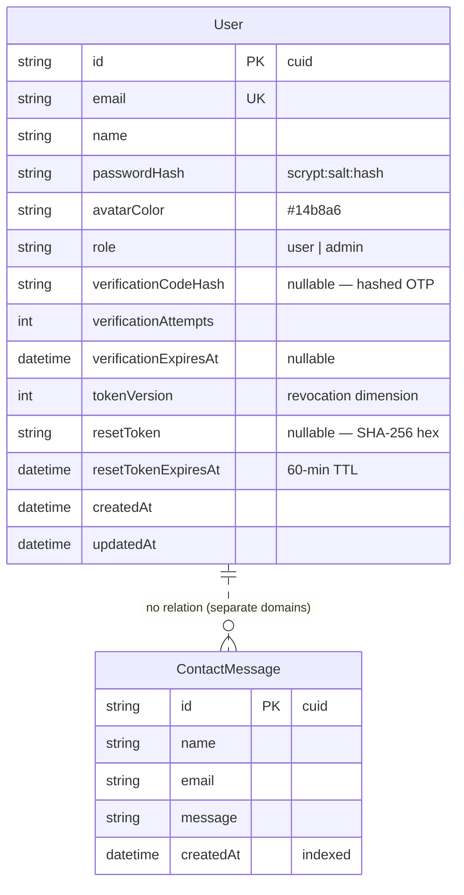

# ViralPost AI — Master Project Architecture Document (PAD) v2.0

**Classification:** Internal Engineering Reference
**Status:** DEFINITIVE, PRODUCTION-LOCKED BLUEPRINT
**Companion Document:** `README.md` (onboarding), `AGENTS.md` (operator quick-reference), `CLAUDE.md` (agent contract), `viralpost-ai_SKILL.md` (distilled memory)
**Last Updated:** 2026-11-09
**Audience:** Senior Engineers, Tech Leads, DevOps, and Onboarding Engineers
**Rule:** Every architectural decision in this document traces to a specific rationale.
Nothing is here "because it's popular."

---

## Table of Contents

1. [System Overview & Decisions](#1-system-overview--decisions)
2. [High-Level System Topology](#2-high-level-system-topology)
3. [Application Architecture](#3-application-architecture)
4. [Data Architecture](#4-data-architecture)
5. [Design System Reference](#5-design-system-reference)
6. [Security Architecture](#6-security-architecture)
7. [Testing Strategy](#8-testing-strategy)
8. [Build & Deployment](#9-build--deployment)
9. [Developer Handbook](#10-developer-handbook)
10. [Known Issues & Outstanding Tasks](#11-known-issues--outstanding-tasks)
11. [Key Files Reference](#12-key-files-reference)
12. [Glossary](#13-glossary)

---

## 1. System Overview & Decisions

### 1.1 Document Metadata & Purpose

ViralPost AI is a self-hostable clone of
`https://viralpostai.base44.app/` — an AI social media post generator —
built as a **functional superset with visual parity**. This PAD is the
single source of truth for how the clone is put together and why. New
engineers: read §1, §3, §10. Debugging: start at §11 and the skill's
symptom table. Reviewing tech choices: the ADRs below.

The repo was previously the NEO-CRM clone (the "template family"); the
session-1 build replaced the CRM domain with ViralPost AI's while keeping
the battle-tested infrastructure seams (auth, db-path, rate limiting,
the gate). git history carries the CRM lineage.

### 1.2 Technology Stack Summary

| Layer | Technology | Version | Key Rationale |
|---|---|---|---|
| Web framework | Next.js (App Router) | 16.4.2 | The template's standing stack; SSR metadata + route handlers is the SEO/robustness superset over the reference's SPA |
| UI runtime | React | 19.3.1 | Ships with Next 16; client islands only where interactivity demands |
| Language | TypeScript | 5.9.3 (strict) | The build is the type gate (`ignoreBuildErrors` never set) |
| Styling | Tailwind CSS | 4.3.3 (CSS-first) | The reference is Tailwind-classed; the template's v4 doctrine (literal hex `@theme`, `@custom-variant hover`) is carried and test-pinned |
| PostCSS | @tailwindcss/postcss | ^4 | The only plugin |
| ORM | Prisma | 6.19.3 | The template's seam-tested data layer |
| Database | SQLite (dev) | — | `db/custom.db` at the repo root; PostgreSQL swap documented in `.env.example` |
| Validation | Zod | 4.6.7 | Every API boundary |
| Icons | lucide-react | 0.525.0 | The reference's own icon family (bundle-decoded) |
| Unit tests | Vitest | 5.0.5 | Node env, `@` alias, `*.test.ts` only |
| E2E | @playwright/test | 1.64.1 | Against the production standalone build |
| A11y | axe-core | 4.x | Assertions inside the e2e suite |
| Runtime | Bun | 1.3.14 | Scripts run from the repo root |

**Dependency diet (session 2):** the CRM-era packages the new domain never
imported were removed — `zustand`, `recharts`, `jspdf`, `html2canvas-pro`,
`class-variance-authority`, and six `@radix-ui/*` primitives. The runtime
dependency surface is exactly: `@prisma/client`, `clsx`, `lucide-react`,
`next`, `prisma`, `react`, `react-dom`, `tailwind-merge`, `zod`. The toast
is a from-scratch subscribe/store hook that mirrors the Radix toast API
shape; the reveal/particle/WebGL effects are dependency-free.

### 1.3 Architecture Decision Records

**ADR-001: Keep the template's Next.js 16 standalone stack (do not re-scaffold as an SPA)**

- **Context:** The reference is a Vite-style React SPA on the Base44
  platform. A clone could mirror that shape exactly.
- **Decision:** Keep Next.js 16 App Router with `output: "standalone"`,
  ported from the NEO-CRM template.
- **Rationale:** SSR/SSG metadata, real route handlers, and true HTTP
  statuses are precisely the capabilities the reference's SPA lacks —
  they ARE the superset. The template's seams (db-path, auth, rate limit)
  carry 200+ sessions of hardening.
- **Consequences:** Server/client component discipline required; the
  unknown-route 404 needed a catch-all architecture (ADR-006). Positive:
  SEO, testability, one deployable artifact.
- **Alternatives rejected:** A Vite SPA clone (would replicate the
  reference's 200-everywhere and client-only metadata); keeping the CRM
  domain (wrong product).

**ADR-002: The generator is a deterministic local engine, not an LLM call**

- **Context:** The reference's generator calls its platform LLM
  (`InvokeLLM`), which was observed returning **HTTP 402** (quota
  exhausted) with the UI hanging at "Generating…" forever — logged out
  AND logged in (docs/reference-investigation.md §5 D-1).
- **Decision:** `src/lib/generator.ts` is a pure function
  `generatePost(idea, seed)` implementing the reference's own prompt
  rules (hook first line, 1-2 sentence paragraphs, emotional tone, 5-8
  hashtags, < 200 words, no labels) with niche banks (fitness, business,
  lifestyle, fashion, food, travel, motivation, tech + evergreen
  fallback). The API route passes a crypto-random seed. The reference's
  exact prompt is preserved in `generatorPrompt()` for a future
  provider face.
- **Rationale:** The core feature must actually work, offline, with zero
  keys. Determinism makes the contract property-testable.
- **Consequences:** Posts are formula-driven, not model-generated; an
  optional OpenAI-compatible provider can be wired behind env without
  touching the contract.
- **Alternatives rejected:** Calling a real LLM by default (needs keys,
  non-deterministic, untestable offline); shipping the 402 hang (a
  regression, not a clone).

**ADR-003: Free quota = the reference's client counter + a server rate limit**

- **Context:** The reference tracks generations in
  `localStorage["viralpost_generations"]` (3/day, daily reset) —
  client-trustworthy only.
- **Decision:** Replicate the counter verbatim (`src/lib/generation-counter.ts`
  — pure functions + a `useSyncExternalStore` adapter) for the UX, and add
  an IP-keyed server rate limit on `/api/generate` (20 / 15 min) for the
  wall.
- **Rationale:** Same visible behavior as the reference; the API can't be
  scripted around the client wall.
- **Consequences:** A logged-out user who clears storage sees the quota
  refresh — same as the reference. The limiter is in-process (single-node
  posture, §6).
- **Alternatives rejected:** Server-side quota with a Generation row
  (needs auth for the core flow — the reference allows logged-out
  generation); no limiter (abuse-open).

**ADR-004: httpOnly HMAC cookie sessions (not the reference's localStorage token)**

- **Context:** The reference stores its token in localStorage —
  XSS-readable, no revocation.
- **Decision:** Port the template's auth family wholesale: scrypt
  password hashes (per-user salt, constant-time compare, timing
  equalizer), HMAC-SHA256-signed stateless cookies
  (`base64url({uid,iat,exp,v}) + "." + hex_sig`, httpOnly, lax,
  secure-in-prod, 7-day TTL), the `tokenVersion` revocation dimension
  (password reset kills every prior cookie), hashed-at-rest single-use
  reset tokens, no-enumeration forgot-password, per-IP rate limits.
- **Rationale:** Security hardening is the documented superset doctrine;
  the seam is the template's most valuable inheritance.
- **Consequences:** More moving parts than a token in localStorage; all
  battle-tested and pinned by the unit suite (the auth-family checks
  inside the 488-test gate).
- **Alternatives rejected:** Mirroring localStorage auth (a downgrade);
  NextAuth/JWT libraries (more dependencies, less control).

**ADR-005: Tailwind v4 CSS-first with the template's trap mitigations**

- **Context:** Tailwind v4 has known traps (bare HSL triplets in `@theme`
  resolve to transparent; the default oklch palette drifts; `hover:`
  sticks on touch devices).
- **Decision:** Tokens in `globals.css` `@theme` with literal hex;
  the `@custom-variant hover` unwrap; the design-tokens and typography
  test suites pin the theme textually. (Session-11, F11-2: the vendored
  animate-utilities file that originally rode this ADR was RETIRED — it
  shipped dead keyframes on a phantom Radix claim; the step-less color
  census + the dead-token census in `tests/design-tokens.test.ts` are
  the guard rails.)
- **Rationale:** The reference is Tailwind-classed (`bg-slate-900`,
  `from-teal-500`…); class-for-class parity requires the same engine
  without v4's foot-guns.
- **Consequences:** No `tailwind.config.js` ever; token changes update
  the pinning tests in the same commit.
- **Alternatives rejected:** v3 config style (fights v4's engine);
  CSS-in-JS (wrong engine entirely).

**ADR-006: The unknown-route 404 — title in the catch-all LAYOUT, notFound() in the page**

- **Context:** The reference (an SPA) titles unknown routes
  `<StartCase(last segment)> | ViralPost AI` (`/Dashboard` →
  "Dashboard | ViralPost AI") and answers HTTP 200. Next's not-found
  boundary cannot read the unmatched path server-side, and a page's
  `generateMetadata` is **discarded** when the page calls `notFound()`
  (probe-verified session 2). A client-side title effect is stomped by
  React's metadata hydration (observed live).
- **Decision:** `src/app/[...catchAll]/` owns unknown routes: the
  segment **layout**'s `generateMetadata` derives the ABSOLUTE title from
  params (`unknownRouteTitle()` — non-alnum runs split, camelCase splits,
  digits never split, upperFirst per word, empty → bare title); the page
  calls `notFound()`; the segment `not-found.tsx` renders the standard
  404 body. Result: derived title in the SSR HTML + true 404 status +
  `noindex` — verified across 13 unit pins and an e2e assertion.
- **Rationale:** Layouts render around not-found boundaries, so their
  metadata survives — the only SSR-correct home for the derivation.
- **Consequences:** The 404 body renders through the client stream (the
  curl HTML carries title/status/noindex, not the body text) — the same
  client-rendered posture as the reference's SPA 404; the rendered-body
  contract is owned by the e2e layer. The root `not-found.tsx` remains
  for in-app `notFound()` calls.
- **Alternatives rejected:** Client-side title effect (stomped — race
  with React metadata); a static root 404 with the bare title (the
  parity gap this ADR closes); a route handler rendering hand-built HTML
  (duplicates the head).

**ADR-007: The contact form persists; the reference's is a stub**

- **Context:** The reference's contact form makes zero network calls on
  submit (client-side stub — investigation §5 D-2).
- **Decision:** `POST /api/contact` → Zod-validated `ContactMessage`
  row in SQLite, "Message Sent!" confirmation.
- **Rationale:** An advertised action must be real.
- **Consequences:** One more model + endpoint; trivial.
- **Alternatives rejected:** Mirroring the stub (a defect, not parity).

**ADR-008: SQLite at the repo root through the db-path seam**

- **Context:** Relative `file:` URLs resolve differently per reader
  (Prisma CLI anchors at the schema; the standalone server chdirs
  before modules load) — the template family's most-bitten contract.
- **Decision:** `DATABASE_URL="file:../db/custom.db"` with `db/` at the
  repo root; `src/lib/db-path.ts` is the only sanctioned runtime
  resolver; npm scripts pin or strip the env; the seed routes through
  the seam.
- **Rationale:** Proven across the template family (the empirical
  natural experiment: the disciplined sibling ran 35/35 smoke under a
  polluted shell, the undisciplined one fell to 12/30).
- **Consequences:** `tsc`/tests never depend on CWD; symptom of a break
  is the documented `Error code 14`.
- **Alternatives rejected:** Absolute paths in dev (breaks the
  clone-and-run story); env-only resolution (the CWD trap).

---

## 2. High-Level System Topology

```
┌─────────────────────────────────────────────────────────────┐
│ Browser                                                     │
│  - Marketing pages (SSR HTML + client islands)              │
│  - Generator card → fetch /api/generate                     │
│  - localStorage: viralpost_generations (3/day UX counter)   │
└──────────────┬──────────────────────────────────────────────┘
               │ HTTPS (cookie: viralpost_session, httpOnly)
┌──────────────▼──────────────────────────────────────────────┐
│ Next.js standalone server (bun .next/standalone/server.js)  │
│                                                             │
│  Pages (RSC):  / · /Tool · /Pricing · /Contact ·            │
│                /login · /signup · /reset-password ·         │
│                /[...catchAll] (404 + derived title)         │
│  Handlers:     /api/generate · /api/contact · /api/health · │
│                /api/auth/{login,logout,me,signup,verify,    │
│                           resend,forgot-password,           │
│                           reset-password}                   │
│  Seams (lib):  generator · generation-counter · auth ·      │
│                password · rate-limit · db-path · site ·     │
│                route-title · api (envelope/reader) ·        │
│                schemas · page-layout · chunk-recovery       │
└──────────────┬──────────────────────────────────────────────┘
               │ Prisma (SQLite)
┌──────────────▼──────────────────────────────────────────────┐
│ db/custom.db  (User · ContactMessage)                       │
└─────────────────────────────────────────────────────────────┘
```

Scaling characteristics: single-node by design (in-process rate limiter,
SQLite). Multi-instance production requires PostgreSQL + `prisma migrate`
+ a shared-store limiter + `VIRALPOST_PROXY_HOPS` — documented in
`docs/DEPLOYMENT.md`.

---

## 3. Application Architecture

### 3.1 The Layer Model

```
Layer 0  prisma/schema.prisma   — User, ContactMessage. The data truth.
Layer 1  src/lib/*              — pure seams. No upward imports; the
                                  most-tested code in the repo.
Layer 2  src/app/api/*          — route handlers. Thin: gate → read →
                                  parse → Prisma → envelope.
Layer 3  src/components/*       — marketing shell, effects, layout
                                  cards, the ui/toast. Client islands
                                  are explicit ("use client").
Layer 4  src/app/*              — pages + layouts. Thin; metadata via
                                  pageMetadata(); the catch-all owns
                                  the 404 contract (ADR-006).
```

The Golden Rule: imports point DOWN only. A component never imports a
route handler; a seam never imports a component.

### 3.2 Annotated Directory Structure

```
viralpost-ai/
├── prisma/schema.prisma        ← User + ContactMessage (SQLite)
├── prisma/seed.ts              ← idempotent demo user (upsert-by-email)
├── db/                         ← custom.db · e2e.db · smoke.db (gitignored)
├── public/                     ← og-image.png · portrait · screenshots/
├── src/
│   ├── app/
│   │   ├── (site)/             ← public chrome: layout (Navbar+Footer),
│   │   │                          page.tsx (landing), Tool/, Pricing/, Contact/
│   │   ├── [...catchAll]/      ← ADR-006: layout (title) + not-found (body)
│   │   │                          + page (notFound())
│   │   ├── api/                ← generate · contact · health · auth/*
│   │   ├── login/ signup/ reset-password/
│   │   ├── layout.tsx          ← root: metadata, viewport, Toaster
│   │   ├── not-found.tsx       ← the root 404 boundary (in-app notFound())
│   │   ├── not-found-body.tsx  ← the shared 404 body (client, usePathname)
│   │   ├── error.tsx global-error.tsx   ← error boundaries
│   │   └── globals.css         ← THE theme (Tailwind v4 @theme)
│   ├── components/
│   │   ├── marketing/          ← navbar (mobile menu) · footer · hero ·
│   │   │                          sections (10 landing blocks) ·
│   │   │                          generator-card · contact-form · logo ·
│   │   │                          nav-config (the shared vocabulary)
│   │   ├── effects/            ← iridescence (WebGL) · particle-text
│   │   │                          (canvas) · reveal (IntersectionObserver)
│   │   ├── layout/             ← login-card (5 views: signin/reset/sent/signup/verify) · reset-password-screen
│   │   └── ui/toast.tsx        ← the subscribe/store toast
│   └── lib/                    ← THE seams (see §12 Key Files)
├── tests/                      ← 37 unit suites + e2e/ (9 specs)
├── scripts/                    ← smoke-test.sh · census.ts · prisma-env.ts
├── docs/                       ← plans/ · reference-investigation.md ·
│                                  implementation-plan.md · session logs ·
│                                  screenshots/ · DEPLOYMENT.md · the SSH
│                                  wrapper + its runbook
├── skills/                     ← the owner's skill catalog (NOT app code;
│                                  excluded from tsc/eslint/vitest; the
│                                  smoke artifact-hygiene leg asserts the
│                                  build never ships it)
├── AGENTS.md · CLAUDE.md · README.md · worklog.md
├── viralpost-ai_SKILL.md       ← the distilled engineering memory
└── Project_Architecture_Document.md   ← this file
```

### 3.3 Critical Code Patterns

**Pattern 1 — the pure seam (the repo's core discipline):**

```typescript
// src/lib/generation-counter.ts — logic as pure functions over inputs;
// the DOM adapter is a thin, guarded tail.
export function usedToday(record: QuotaRecord | null, today: string): number {
  if (!record || record.date !== today) return 0;  // the daily reset
  return record.count;
}
// The localStorage adapters fail OPEN (storage unavailable → 0 used) —
// the server rate limit is the actual wall, never the client store.
```

Why: the counter, the title derivation, the generator, the auth token
format — every rule that can break silently is a pure function with a
spec, testable in node without a DOM.

**Pattern 2 — the envelope + bounded reader (every API route):**

```typescript
const read = await readBoundedJson(req);        // Content-Type gate +
if (read.tooLarge) return fail("BAD_REQUEST", "Request body too large");
const parsed = bodySchema.safeParse(read.value); // Zod at the boundary
if (!parsed.success) return fail("BAD_REQUEST", "Describe your post idea first.");
```

Why: the login-CSRF class (non-JSON Content-Type) and payload bombs are
rejected before parsing; handlers never throw across the boundary.

**Pattern 3 — the catch-all 404 (ADR-006, the session-2 find):**

```typescript
// src/app/[...catchAll]/layout.tsx — the title derivation LIVES HERE
// because Next discards a page's generateMetadata when the page calls
// notFound() (probe-verified), but layouts render around the boundary.
export async function generateMetadata({ params }) {
  const { catchAll } = await params;
  return { title: { absolute: unknownRouteTitle(`/${catchAll.join("/")}`) } };
}
// src/app/[...catchAll]/page.tsx
export default function CatchAllPage(): never { notFound(); }
```

Why: the only SSR-correct home for the reference's per-route 404 titles.

**Pattern 4 — useSyncExternalStore for persisted UI state:**

```typescript
// src/components/marketing/generator-card.tsx — the quota counter reads
// through a store subscription (hydration-safe; no setState-in-effect).
const used = React.useSyncExternalStore(subscribeUsage, getUsedTodayLive, () => 0);
```

Why: React 19 rejects effect-cascaded state; the server snapshot is 0
and settles client-side without a hydration mismatch.

**Pattern 5 — source-pinned tests (the docs/markup contract):**

```typescript
// tests/page-titles.test.ts — suites READ the source files textually and
// pin contracts (titles, classes, theme hexes). When markup changes, the
// pin updates in the same commit — the test IS the changelog.
expect(layout).toMatch(/<html lang="en" data-scroll-behavior="smooth">/);
```

Why: the parity surface (titles, tokens, classes) is too broad for e2e
alone; textual pins catch silent drift at unit speed.

---

## 4. Data Architecture

### 4.1 Database Schema



### 4.2 Data Models

Two models by design. The generator is stateless (ADR-003): the UX quota
is the client counter; the abuse wall is the rate limiter — a Generation
row would add nothing either side reads.

### 4.3 Persistence Strategy

- `PrismaClient` is constructed in exactly one place (`src/lib/db.ts`)
  with the URL from `db-path.ts` (ADR-008).
- The seed routes through the same seam and upserts by email (row ids
  survive reseeds, so live session cookies keep resolving).
- Dev uses `db push`; production uses `prisma migrate` (documented swap
  to PostgreSQL in `.env.example` and `docs/DEPLOYMENT.md`).
- `bun run db:census` asserts the pristine contract (1 demo user, 0
  contact messages) — the standing drift probe.

---

## 5. Design System Reference

### 5.1 Typographic System

The system font stack — the reference ships **zero webfonts** (verified
in its bundle and network log). `--font-sans` in `globals.css` pins the
exact stack; the typography test suite pins the absence of any font
variable on `<html>`.

### 5.2 Color Tokens

`@theme` in `globals.css`, literal hex only (ADR-005). The
brand pairs: teal primary (`#14b8a6` family — buttons, active states,
the hero glow) and amber accent (`#f59e0b` family — the Upgrade pill,
stat cards) over slate neutrals with white surfaces. The
design-tokens test suite pins the theme block textually.

### 5.3 Component Primitives

One primitive (`components/ui/toast.tsx`) — a from-scratch
subscribe/store toast mirroring the Radix API shape without the
dependency. Everything else is bespoke marketing markup class-for-class
from the reference (the parity doctrine); layout geometry constants live
in the test-pinned `src/lib/page-layout.ts`.

### 5.4 Motion / Animation

- `Reveal` — IntersectionObserver + CSS transitions;
  `prefers-reduced-motion` collapses them.
- `ParticleText` — canvas particle title, 4 cycling phrases with
  vaporize/fadeIn transitions; SSR-safe (an `<h1>` with sr-only text
  renders first).
- `Iridescence` — WebGL fragment shader (hue 174, the reference's
  config shape), aspect-aware composition: desktop radial burst + mist
  + top band; mobile dark field + horizontal flow-band + bottom pool.
  CSS-gradient fallback when WebGL is unavailable.

---

## 6. Security Architecture

### 6.1 Security Rules

| Rule | Enforcement |
|---|---|
| Every external input validated (Zod) before use | `readBoundedJson` + schema at each handler; unit-pinned |
| Parameterized queries only | Prisma, exclusively |
| Passwords: scrypt + per-user salt + constant-time compare + timing equalizer | `src/lib/password.ts` (pure crypto seam) |
| Sessions: HMAC-signed httpOnly cookie, lax, secure-in-prod, 7-day TTL, tokenVersion revocation | `src/lib/auth.ts` |
| `AUTH_SECRET` ≥ 16 chars or production refuses to boot | `src/instrumentation.ts` → `boot-env.ts` (the boot gate — smoke leg 14) |
| Boot flag-typo guard: unknown `VIRALPOST_*` knobs and legacy `NEO_*` spellings both warn at boot (the closed set is read verbatim) | `src/lib/boot-env.ts` (session-3, F3-1) |
| In-app-delivery polarity warning: production + an unset `VIRALPOST_DISABLE_IN_APP_OTP`/`_RESET` warns at boot (the live-token-in-response hazard — the reset link and the OTP ride the API responses by default) | `src/lib/boot-env.ts` (session-13, S13-1) |
| Reset tokens: 32-byte, hashed at rest, single-use, atomic consume, 60-min TTL | `api/auth/reset-password` |
| Forgot-password is no-enumeration | always-200 shape |
| Auth routes rate-limited per IP with Retry-After; proxy-hop depth fails closed | `src/lib/rate-limit.ts` + `VIRALPOST_PROXY_HOPS` |
| Content-Type CSRF gate + bounded body reads | `src/lib/api.ts` |
| OTP/reset in-app delivery OFF in production | `VIRALPOST_DISABLE_IN_APP_OTP/_RESET` |
| Secrets never in logs, commits, or envelopes (the documented demo exception: signup/resend log the live OTP code to the SERVER console for the mail-less self-hosted workflow — never to the client; since session-13 the log rides the SAME `VIRALPOST_DISABLE_IN_APP_OTP` gate as the response payload, so the mail-transport posture writes no codes to stdout) | `.env` gitignored; `.env.example` mirrors the contract |
| No `dangerouslySetInnerHTML` anywhere | grep-clean |

### 6.2 Security Utilities

`password.ts` (scrypt/verify/equalizer), `auth.ts` (sign/verify sessions,
cookie lifecycle), `rate-limit.ts` (fixed-window, client-key by proxy
depth), `api.ts` (envelope + bounded reader), `boot-env.ts` (the boot
gate + the dual-prefix flag-typo guard), `verification.ts` (OTP TTL
logic).

### 6.3 Authentication & Authorization

Session model: stateless signed cookie + the `tokenVersion` row check at
every `getSessionUser()` — password reset bumps the version and kills
every prior cookie. Roles: `user | admin` on the row; the demo seed is
admin. Public by design: the marketing pages, `/api/generate`,
`/api/contact`, `/api/health`, and the auth family (rate-limited
instead).

### 6.4 Threat Model

Key vectors: credential stuffing (rate limiter + timing equalizer),
session theft (httpOnly + secure + revocation), XSS (React escaping, no
dangerous HTML), CSRF on JSON endpoints (Content-Type gate), quota abuse
(server rate limit), user enumeration on auth endpoints (uniform
responses + equalized timing), secret leakage (boot gate + gitignore +
envelope discipline). Accepted-and-documented: the in-process limiter is
single-node (§11).

---

## 8. Testing Strategy

### 8.1 Test Distribution

| Category | Files | Tests | Location | Framework |
|---|---|---|---|---|
| Unit | 37 | 528 | `tests/*.test.ts` | Vitest (node env) |
| E2E | 9 specs | 54 | `tests/e2e/*.spec.ts` | Playwright (production build) |
| Smoke | 1 script | 15 legs | `scripts/smoke-test.sh` | bash + curl |

### 8.2 Test Patterns

- TDD at the pure seams (red → green); the generator, counter, and
  route-title suites were all written failing-first.
- Source-pinned suites (§3.3 Pattern 5) hold the parity surface.
- E2E: one setup login shared via storageState; specs that need the
  logged-out surface opt out explicitly; axe-core a11y assertions on
  every route at desktop + 390px.
- Property tests (fast-check) on the generator contract.

### 8.3 Coverage Thresholds

No percentage gate; the contract is the gate — every seam has a spec,
every user-visible surface has an e2e pin, every doc count is lockstep
(README/AGENTS/PAD/SKILL carry 528/54/15 and change together), and the
count constants themselves are pinned to the live suites on disk by the
reality census (session-12 — constants vs reality, not constants vs
docs).

### 8.4 Pre-Push Checklist

```bash
bun run gate   # lint → typecheck → unit → build → smoke → e2e
git status     # no .env, *.key, db/*.db, logs, test-results
```

Plus, for visual changes: a live parity walk against the reference
(agent-browser, both widths, both auth states).

---

## 9. Build & Deployment

### 9.1 Production Build

`bun run build` → `.next/standalone/` (server.js + traced deps) with the
copy steps for `.next/static` and `public` folded into the script.
Start: `bun .next/standalone/server.js` from the repo root (or an
absolute `DATABASE_URL` — the seam handles both postures).

### 9.2 Environment Variables

See README §Environment variables — `DATABASE_URL` (required),
`AUTH_SECRET` (production-required, boot-gated), `NEXT_PUBLIC_SITE_URL`
(build-time-inlined), `VIRALPOST_PROXY_HOPS`,
`VIRALPOST_DISABLE_IN_APP_OTP/_RESET` (prod kill-switches). `.env` is
untracked; `.env.example` mirrors the contract and is committed.

### 9.3 Docker

The standalone output containers cleanly, but no Dockerfile ships — add
one per target platform when needed (the family doctrine: don't
cargo-cult).

### 9.4 CI/CD

No hosted CI — the local `bun run gate` is the gate (the operator
contract), and the SSH-wrapper push is the deploy step. Full runbook:
`docs/DEPLOYMENT.md`.

---

## 10. Developer Handbook

### 10.1 Local Setup

```bash
bun install && cp .env.example .env
bun run db:push && bun run db:seed && bun run dev
```

Demo login: `sepnetflix2023@outlook.com` / `$Abcd1234`.

### 10.2 Common Commands

See AGENTS.md §Commands — the full table including one-file test runs,
the census, and the gate chain.

### 10.3 Code Style Rules

ESLint (`next/core-web-vitals` + `next/typescript`, `--max-warnings 0`;
`rules-of-hooks` an error via the preset, while `exhaustive-deps` and
`purity` are deliberately off — the SKILL §3 form) + `tsc --noEmit`
(strict) — both gates, never weakened. Conventional Commits; `main` only.

### 10.4 Git Workflow

Atomic commits to `main` through the full gate; push via
`docs/ssh_git_wrapper_v3.py` (the runbook in
`docs/how-to-git-push-using-ssh-wrapper_SKILL.md` is the authority —
keys never live in the repo). Session logs + worklog are part of the
delivery.

---

## 11. Known Issues & Outstanding Tasks

| Priority | Issue | Impact | Status |
|----------|-------|--------|--------|
| MEDIUM | In-process rate limiter — multi-instance deploys share nothing | An attacker rotating instances dodges per-IP limits | Accepted (single-node posture documented); needs a shared store to lift |
| MEDIUM | The 404 body renders client-side (Next's dynamic-boundary fallback) — curl HTML carries title/status/noindex but not the body text | No SEO body text on unknown routes (they are `noindex` anyway; the reference's SPA ships none either) | Accepted (ADR-006); e2e owns the rendered-body contract |
| LOW | The generator is formula-driven, not model-generated | Post quality ceiling | By design (ADR-002); the provider face is the documented lift |
| LOW | Signup verification codes are delivered in-response (demo mode) until a mail transport is configured | Demo posture in dev | Mitigated in prod by `VIRALPOST_DISABLE_IN_APP_OTP` |
| LOW | `skills/` (the owner's catalog) rides in the repo but is excluded from every gate | Repo weight only | By the owner's design; artifact hygiene asserts it never ships |

Swept at session-2 ship — no open CRITICAL/HIGH items.

---

## 12. Key Files Reference

(The Lines column is the live `wc -l` of each file at the session-11 ship
— pinned by tests/docs-counts.test.ts's inventory census; edit the row in
the same commit as the file.)

| File | Lines | Purpose |
|------|-------|---------|
| `src/lib/generator.ts` | 449 | The deterministic viral-formula engine + the reference's exact prompt |
| `src/lib/generation-counter.ts` | 102 | The 3/day quota: pure functions + the store adapter |
| `src/lib/route-title.ts` | 56 | The unknown-route title derivation (ADR-006) |
| `src/lib/from-url.ts` | 26 | The from_url open-redirect guard (session-13, S13-4) |
| `src/lib/auth.ts` | 184 | Sessions: sign/verify, cookie lifecycle, tokenVersion |
| `src/lib/password.ts` | 67 | scrypt hash/verify + the timing equalizer |
| `src/lib/rate-limit.ts` | 134 | Fixed-window limiter, proxy-hop-aware client key |
| `src/lib/db-path.ts` | 239 | THE database path resolver (ADR-008) |
| `src/lib/site.ts` | 138 | The metadata factory + canonical origin seam |
| `src/lib/api.ts` | 222 | The envelope + the bounded JSON reader |
| `src/app/globals.css` | 217 | The Tailwind v4 theme (ADR-005) |
| `src/components/marketing/navbar.tsx` | 174 | The nav + the mobile menu (parity-verified) |
| `src/components/marketing/generator-card.tsx` | 191 | The core surface: quota dots, generate, copy, paywall |
| `src/components/effects/iridescence.tsx` | 221 | The WebGL hero background (aspect-aware shader) |
| `src/components/effects/particle-text.tsx` | 311 | The canvas particle title |
| `src/app/[...catchAll]/layout.tsx` | 32 | The 404 title owner (ADR-006) |
| `prisma/schema.prisma` | 60 | User + ContactMessage |
| `scripts/smoke-test.sh` | 175 | The 15-leg artifact ladder |

---

## 13. Glossary

- **The reference** — `https://viralpostai.base44.app/`, the app being
  cloned; every parity claim cites a live capture of it.
- **The template family** — the sibling codebases (neo-crm, digma,
  project-management, zero-balance) this repo's infrastructure seams
  descend from.
- **The gate** — `bun run gate`: lint → typecheck → unit → build →
  smoke → e2e. The only CI that exists.
- **Seam** — a pure module in `src/lib/` with a spec; the unit of
  testability.
- **Deviations Ledger** — `docs/implementation-plan.md` §6: every place
  the clone deliberately differs from the reference, with rationale.
- **Parity walk** — a live, browser-driven comparison against the
  reference (screenshots + computed styles), the acceptance test for
  visual work.
- **The boot gate** — the production refusal to serve without a valid
  `AUTH_SECRET` (instrumentation → boot-env).
