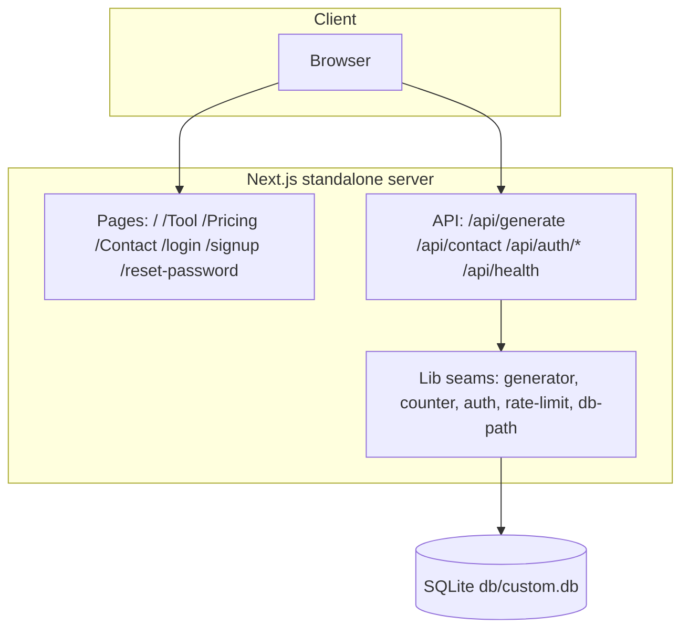

# ViralPost AI

[](https://nextjs.org/)
[](https://react.dev/)
[](https://www.typescriptlang.org/)
[](https://tailwindcss.com/)
[](https://www.prisma.io/)
[](#testing)
[](#license)

A complete, self-hostable clone of
[`viralpostai.base44.app`](https://viralpostai.base44.app/) — the AI social
media post generator — built as a single Next.js application. It is a
**functional superset** of the reference (the generator actually works, the
contact form actually persists, unknown routes answer a true 404) while
holding **visual parity** (class-for-class pages, the WebGL hero, the
particle title, the mobile menu).

## Overview

The reference app sells one thing: describe a post idea, get a
viral-ready social media post. This clone reproduces the whole product —
marketing landing, generator tool, pricing, contact, and the auth funnel —
on a self-hostable stack, and fixes the reference's own defects where it
found them (see [Deviations from the reference](#deviations-from-the-reference)).

## Key features

| Feature | What it does |
|---|---|
| ✨ AI post generator | Deterministic viral-formula engine (hook → 1-2 sentence paragraphs → 5-8 hashtags, < 200 words) — works offline, no API key needed |
| 📊 Free quota | 3 free generations/day with teal fill-dots UI, daily reset, a paywall swap at the limit — plus a server-side IP rate limit the reference lacks |
| 📋 Copy round-trip | One-click copy of the generated post with a Copied! state |
| 🔐 Auth funnel | Email/password signup with verification, login, logout, forgot/reset password — scrypt hashes, HMAC-signed httpOnly cookies, tokenVersion revocation |
| ✉️ Contact form | Persists messages to SQLite (the reference's form is a client-side stub) |
| 🌊 WebGL hero | Iridescence background shader + canvas particle title (4 cycling phrases) — the reference's signature hero, rebuilt dependency-free |
| 📱 Mobile menu | The reference's working dropdown menu, plus Escape/route-change close and readable panels on light pages |
| 🚫 True 404s | Unknown routes answer HTTP 404 with the reference's designed page and its derived `<Route> | ViralPost AI` title (the reference's SPA answers 200 for everything) |
| 🔎 SEO | Per-route metadata, sitemap.xml, robots.txt, PWA manifest, OG/Twitter cards |

## Architecture

One deployable unit: a Next.js App Router application + a SQLite file.
`next build` produces a standalone server.

| Layer | Technology | Version | Purpose |
|---|---|---|---|
| Framework | Next.js (App Router, standalone output) | 16.4 | Pages, API route handlers, SSR metadata |
| UI runtime | React | 19.3 | Server components by default; client islands for interactivity |
| Language | TypeScript (strict) | 5.9 | `tsc --noEmit` is a gate — the build is the type gate |
| Styling | Tailwind CSS (CSS-first) | 4.3 | `@theme` literal hex in `globals.css`; no `tailwind.config.js` |
| ORM / DB | Prisma + SQLite | 6.19 | `db/custom.db` at the repo root; PostgreSQL swap documented |
| Validation | Zod | 4.6 | Every API boundary |
| Icons | lucide-react | 0.525 | The reference's own icon family |
| Unit tests | Vitest | 5.0 | 39 files / 672 tests, node env, pure seams |
| E2E | Playwright | 1.64 | 9 specs / 65 tests against the production build |
| A11y | axe-core | 4.x | A11y assertions inside the e2e suite |
| Runtime | Bun | 1.3 | Scripts run from the repo root |



## File hierarchy

```
📂 viralpost-ai/
├── 📂 prisma/                 schema + idempotent seed (demo user)
├── 📂 db/                     SQLite databases (gitignored, .gitkeep'd)
├── 📂 public/                 og-image, hero portrait (screenshots live in docs/)
├── 📂 src/
│   ├── 📂 app/
│   │   ├── 📂 (site)/         landing, Tool, Pricing, Contact (+ shared chrome)
│   │   ├── 📂 [...catchAll]/  the 404: derived title + true status
│   │   ├── 📂 api/            generate, contact, health, auth family
│   │   ├── 📂 login/ signup/ reset-password/
│   │   ├── layout.tsx         root layout, metadata, viewport
│   │   └── globals.css        the Tailwind v4 theme (teal/amber tokens)
│   ├── 📂 components/
│   │   ├── 📂 marketing/      navbar, footer, hero, sections, generator card
│   │   ├── 📂 effects/        iridescence (WebGL), particle-text, reveal
│   │   ├── 📂 layout/         login card, reset-password screen
│   │   └── 📂 ui/             toast
│   └── 📂 lib/                the pure seams (generator, counter, auth,
│                              rate-limit, db-path, site, route-title, …)
├── 📂 tests/                  39 unit suites + 📂 e2e/ (9 Playwright specs)
├── 📂 scripts/                smoke-test.sh, census, prisma-env
├── 📂 docs/                   plans, reference investigation, screenshots
├── 📂 skills/                 the owner's skill catalog (not app code)
└── 📄 AGENTS.md · CLAUDE.md · worklog.md · Project_Architecture_Document.md
```

## Quick start

Requirements: **Bun ≥ 1.3** (or Node ≥ 20), a POSIX shell.

```bash
git clone https://github.com/nordeim/viralpost-ai.git
cd viralpost-ai
bun install
cp .env.example .env           # then set AUTH_SECRET for anything non-dev
bun run db:push                # schema → db/custom.db
bun run db:seed                # idempotent demo data
bun run dev                    # http://localhost:3000
```

**Verify setup:**

```bash
bun run db:census              # → "pristine: MATCH (1 user + 0 contact messages)"
curl -s localhost:3000/api/health   # → {"ok":true,"data":{"status":"healthy",...}}
```

Demo login (mirrors the reference app):
`sepnetflix2023@outlook.com` / `$Abcd1234`.

## Environment variables

| Variable | Required | Purpose |
|---|---|---|
| `DATABASE_URL` | yes | `file:../db/custom.db` (SQLite; resolves against `prisma/schema.prisma`). PostgreSQL example in `.env.example` |
| `AUTH_SECRET` | **production: yes** | HMAC key for session cookies (≥ 16 chars, `openssl rand -hex 32`). Missing/short in production = the server refuses to boot |
| `NEXT_PUBLIC_SITE_URL` | recommended | Canonical origin for metadata/sitemap/robots — inlined at build time, set before `bun run build` |
| `VIRALPOST_PROXY_HOPS` | behind a proxy | Trusted proxy depth for rate-limit IP keying (unset = 1; unparsable fails closed) |
| `VIRALPOST_DISABLE_IN_APP_OTP` | production | Set to `1` when a real mail transport owns verification-code delivery (unset in production prints a boot warning — the code rides the responses) |
| `VIRALPOST_DISABLE_IN_APP_RESET` | production | Set to `1` when a real mail transport owns reset-link delivery (unset in production prints a boot warning — the link rides the response) |

## Testing

```bash
bun run test            # Vitest unit suite (39 files / 672 tests)
bun run test:e2e        # Playwright e2e (9 specs / 65 tests) — needs bun run build first
./scripts/smoke-test.sh # 16-leg curl ladder against the standalone build
bun run gate            # lint + typecheck + unit + build + smoke + e2e, in order
```

One-time setup for e2e: `bunx playwright install chromium` (bun's
`trustedDependencies` skips Playwright's postinstall, so the browser
never downloads implicitly on a fresh clone).

The e2e suite boots the **production standalone build** on its own port
with its own scratch database (`db/e2e.db`) — the dev server lies about
production hydration. One setup project signs the demo user in once and
shares the session via `storageState` (per-test logins would trip the auth
rate limiter).

## API reference

| Endpoint | Method | Auth | Description |
|---|---|---|---|
| `/api/generate` | POST | public (IP-limited) | The generator — `{idea}` → `{ok, data:{text}}` |
| `/api/contact` | POST | public | Persist a contact message (Zod-validated) |
| `/api/health` | GET | public | Liveness + db round-trip |
| `/api/auth/signup` | POST | public | Create account, start verification |
| `/api/auth/verify` | POST | public | Verify the email code |
| `/api/auth/resend` | POST | public | Resend the code (own limit) |
| `/api/auth/login` | POST | public | Session cookie |
| `/api/auth/logout` | POST | session | Clear the session |
| `/api/auth/me` | GET | public (session-reported) | The session envelope (data:null when logged out, never 401) |
| `/api/auth/forgot-password` | POST | public | No-enumeration reset request |
| `/api/auth/reset-password` | POST | public | Atomic single-use token consume |
| `/api/*` (unknown) | any | public | The envelope's JSON 404 — subpaths via the `[...path]` catch-all, the bare `/api` via its own route (never the HTML 404 body) |

All bodies are JSON, validated with Zod, read through a bounded reader
(Content-Type gate + length checks). Responses use the envelope
`{ok, data} | {ok:false, error:{code, message}}`.

## Design system

- **Tokens** (in `src/app/globals.css`, `@theme` with literal hex):
  teal primary (`#14b8a6` family), amber accent (`#f59e0b` family), slate
  neutrals, white surfaces. The Tailwind source scan is scoped to `src/`
  (`@import "tailwindcss" source("../")` — session-35, S35-1): v4's
  auto source detection anchors at the repo ROOT and shipped ~60%
  never-matched rules compiled out of the docs/tests/*.md + skills/
  prose. The base layer carries the button cursor rule
  (`button, [role="button"] { cursor: pointer }` — session-36, S36-1):
  v4's preflight ships no cursor rule, and the reference's v3-era
  preflight renders pointer on every enabled button.
- **Type**: the system font stack (the reference ships zero webfonts).
- **Motion**: `Reveal` (IntersectionObserver + CSS transitions,
  `prefers-reduced-motion` aware), the hero's canvas particle cycle and
  WebGL shader; reduced-motion collapses all of it.
- **Layout constants** live in one test-pinned module (`src/lib/page-layout.ts`).

## Deviations from the reference

Recorded in full in `docs/implementation-plan.md` §6. The headline items:

| Area | Reference | Clone | Why |
|---|---|---|---|
| Generator backend | Platform LLM — observed **402-quota-dead**, hangs at "Generating…" forever | Working local engine (a documented provider wire-in point — the exact prompt preserved by `generatorPrompt()`; no provider env is read today) | The core feature must work |
| Unknown routes | SPA answers 200 everywhere; title `startCase(path)` | True 404 status + the same derived title + `noindex` | SEO; the title parity is byte-verified |
| Contact form | Client-side stub, no persistence | Persists to SQLite | The advertised action must be real |
| Auth | localStorage token | httpOnly HMAC cookie + tokenVersion revocation | Security |
| `/Home` | Serves a duplicate of `/` | 308 redirect to `/` | Duplicate content |
| Dead UI | Footer `href="#"` socials | Real platform links | Dead controls are defects |
| Free quota | localStorage only | Same UX + server-side IP rate limit | Abuse resistance |

## Deployment

See [`docs/DEPLOYMENT.md`](docs/DEPLOYMENT.md) — standalone output, the
`AUTH_SECRET` boot gate, the absolute-`DATABASE_URL` recommendation, and
the PostgreSQL swap.

## Project status

| Phase | Status | Delivered |
|---|---|---|
| Session 1 — the clone build | ✅ done | Full app, parity walk, 8 screenshots, first push |
| Session 2 — the parity audit | ✅ done | The `/Dashboard` title decode, env rename, dep diet (−11), docs rebuild, the SKILL distillation |
| Session 3 — the rename completion | ✅ done | Guard-layer `NEO_*` → `VIRALPOST_*` finish (dual-prefix boot gate, re-armed e2e pins, dead page metadata removed); captures 13/14 |
| Session 4 — the phantom-reference audit | ✅ done | CRM-era commentary sweep (typography contract, vitest surface, e2e-port shape, fixture); dev-server captures 15/16 |
| Session 5 — the docs-freshness audit | ✅ done | Session-tracking surfaces synced (SKILL round history, status tables, plans map); DEPLOYMENT env table gained the `VIRALPOST_*` knobs; captures 17/18 |
| Session 6 — the clean-tree re-certification | ✅ done | Widened fresh-eyes audit (secondary docs, scripts, configs): zero findings; parity re-verified live; captures 19/20 |
| Session 7 — the dev-script loop + phantom comments | ✅ done | The `dev` tee reload loop cured (A/B-verified, pinned); api.ts dead helpers retired; phantom CRM claims re-attributed (site.ts, not-found, 405/141→170); captures 21/22 |
| Session 8 — the live OG parity + evidence provenance | ✅ done | The reference's per-route OG family discovered live (D-4 superseded) — the prefixed OG description retired to the plain paragraph (TDD, pinned); the 2026-10-01 phantom-census claims re-attributed (verify funnel, headers census, SEO routes, typography); README badge 450→455; captures 23/24 |
| Session 9 — the rate-limiter trust warning + the docs-counts gate | ✅ done | The unset-`VIRALPOST_PROXY_HOPS` production boot warning (the direct-exposure XFF-rotation hazard); the signup `"rep"` role relic → the schema's `"user"`; the reset funnel's read-path outage honesty (503, never a bare 500); the property suite landed (fast-check over the generator + limiter contracts — the PAD claim made true); contact/generate joined the sweep family; the dead-code + phantom-provider retirement; DEPLOYMENT.md rewritten for ViralPost AI (was ORBITAL-era); the neo-crm docs-counts gate adopted (badge 490 = 442+48, unit-pinned); captures 25/26 |
| Session 10 — the dev-origin hydration lock + the palette re-pin completion | ✅ done | The dev server at `127.0.0.1` never hydrated (Next 16 blocks the loopback origin's HMR socket → the mobile menu and every client island inert — live root-caused) — `allowedDevOrigins` cured it (pinned + live A/B); the v3 palette re-pin completed (11 unpinned steps, green-700 visibly drifted) + the mechanical color-census pin; the malformed-`NEXT_PUBLIC_SITE_URL` brick cured (fallback + boot warning); history-navigation menu close (e2e-pinned); the hashtag window exercised (5-7); CTAs → Link; NOT_FOUND_LAYOUT pinned; CRM-lineage test headers re-attributed; the three straggler count sites pinned; badge 512 = 463+49; captures 27/28 |
| Session 11 — the standalone-launch DB re-anchor + the dead-CSS retirement + the verification-funnel closure | ✅ done | `bun run start` with the default relative `.env` could not open the database (bun's absolutization + the session-7 hygiene step had silently killed the session-34 launch-dir recovery — live root-caused; the neo-crm session-212 hoist cured it, TDD + live A/B); the dead-CSS retirement (the vendored tw-animate.css + 13 dead `@theme` tokens + the dead keyframes/utilities — all phantom-justified) + the step-less color census (`border-input` compiled to nothing) + the dead-token census; the verification funnel closed (enforceable login gate on the stored hash, resend re-mints for expired codes, the 403 re-enters the verify view — full-funnel e2e); the signup P2002 race → 400; the over-length idea message; the menu a11y increments (aria-controls + Escape focus return); the OTP paste distribution; the gate-script + doctrine/inventory censuses adopted from neo-crm; badge 538 = 488+50; captures 29/30 |
| Session 12 — the count-reality census + the reset-funnel e2e + the UX-boundary batch | ✅ done | The count constants pinned to the LIVE SUITES ON DISK (the reality census — constants vs reality, not constants vs docs; the a11y matrix extracted so the loop expansion is computed, not assumed); the password-reset funnel's FIRST behavioral e2e (signup → verify → forgot → the in-app link → new password → session → the single-use replay → 400 — the sibling of session-11's verification-funnel e2e); the UX-boundary batch (the 403 re-entry clears the stale demo-code hint, the verify submit honors `from_url`, the OTP paste takes the trailing six digits via the new `otp.ts` seam, the expired-code 400 answers "no longer valid" not "too many attempts"); the effects hygiene (the reduced-motion branch schedules by timeout — no 60 fps rAF redraw loop; the hero re-reads `devicePixelRatio` per resize); the stepped-semantic census arm; the Logo → Link; the dead-export retirement (ERR.FORBIDDEN/NOT_FOUND, the generateVerifyCode re-export); the PAD's stale tw-animate references retired + the semantic-prose census starter + the one-owner doctrine from neo-crm; badge 559 = 507+52; captures 31/32 |
| Session 13 — the in-app-delivery polarity warning + the OTP log gate + the from_url seam | ✅ done | The delivery-polarity boot warning (production + an unset `VIRALPOST_DISABLE_IN_APP_OTP`/`_RESET` now warns — the live-token-in-response hazard, the unset-hops precedent extended); the OTP log line rides the delivery gate (a mail-transport deployment stops writing codes to stdout); the from_url resolver extracted to the pure seam `src/lib/from-url.ts` (the open-redirect guard's FIRST behavioral coverage: 8 unit pins + 2 e2e legs — the `/Tool` round-trip and the foreign-origin fallback, both live-verified); the reduced-motion phrase cadence cured (advance-then-draw — each phrase exactly one window); the verify route's P2025 → 400 mapping; the font-family hoist out of both fit loops; the census forms-guard (no `.each(`/`.skip(`/`.only(` shapes the count regex cannot see); badge 582 = 528+54; captures 33/34 |
| Session 14 — the from_url escape closure + the resend equalizer + the UX-boundary batch | ✅ done | The from_url protocol-relative ESCAPE closed (a same-origin `from_url` with a leading `//` path passed the origin check but navigated cross-origin at the router — live-verified pre-cure, the browser landed on `https://evil.com`; the leading-`//` pathname arm + 3 unit pins + the e2e leg); the resend/verify no-enumeration equalizer (the no-op branch ships the uniform `verificationCode: null` shape; both miss branches burn one scrypt — login's S72-C shape, closing the verification-state oracle signup cannot reveal); the generate route's guests-allowed wiring pinned (the guard only selects the limiter bucket — no phantom 401 wall); the password ceiling symmetry (signup's shared schema gains the 200-char max reset always owned — a 201+ char signup password could never be replaced at reset); InfoCallout's polite `role="status"`; the toast dismiss keyboard focus ring; the reduced-motion inclusive boundary; the depth-0 availability note in DEPLOYMENT.md; badge 593 = 538+55; captures 35/36 |
| Session 15 — the resend P2025 sibling arm + the null-body vocabulary + the API-envelope 404 | ✅ done | The resend route's vanished-row P2025 race joined the sibling doctrine (verify's S13-5 arm / forgot's stored=false — the no-op 200, never a raw 500); the route-local parse sites' null-body vocabulary (contact's Zod dev-message leak retired, generate's non-string idea no longer answers the over-length message — both live-confirmed pre-cure); the API subtree's unknown paths answer the JSON envelope 404 (the true-404 doctrine extended — the HTML 404 body retired, e2e-proven); the signin icons' aria-hidden; the hamburger's house keyboard focus ring (slate-300 — reads on the dark navbar); the Escape focus-return e2e assertion; `prisma` → devDependencies + the zod advisory chain retired via the resolutions pin (audit 10 → 9, all remaining dev-toolchain); badge 599 = 543+56; captures 37/38 |
| Session 16 — the parse-vocabulary completion + the bare-/api envelope + the polish batch | ✅ done | The S16-1 parse-vocabulary completion (the S15-2 genus closed: non-object JSON bodies — string/array/number/boolean — answer the pinned "Invalid request body" on the auth family AND contact; the three schema fields (verify's code, reset's new_password, signup's password) gain `{ message }` type-faces — no Zod dev-message reaches any client, 5 live-confirmed surfaces cured, 5 mutation batteries); the bare `/api` envelope 404 (S16-2 — the one shape a required catch-all can't match, `src/app/api/route.ts` closes the doctrine's last escaping shape, e2e-proven); the polish batch (S16-4 the dead `reducedRef` retired, S16-5 the footer-year build-time freeze documented as a deviation, S16-7 the generate-429 deviation comment, S16-3 the eslint off-switch blast radius re-recorded, S16-6 the PAD §12 header refreshed); badge 604 = 548+56; captures 39/40 |
| Session 17 — the comment-truth batch + the README table repair + the CSRF media-type parse + the timer hygiene | ✅ done | The audit round at 0 Critical / 0 High / 0 Medium (2 Low / 6 Info, all cured or verified): the forgot-password rationale's phantom "409" (signup answers 400); the Project status table repaired (the interior blank lines had broken GFM rendering — sessions 13–16 rendered as prose); the content-type CSRF gate now PARSES the media type (`text/x-application/json` / `application/jsonx` never pass — TDD + mutation battery); the two marketing reset timers ref-tracked (the toast's unmount idiom mirrored, source-pinned); the generate route's discarded-500 degradation documented; the DEPLOYMENT re-seed note; the "exactly 2 exhaustive-deps flags" register claim independently re-verified live; badge 606 = 550+56; captures 41/42 |
| Session 18 — the OPTIONS-envelope closure + the DEPLOYMENT count re-anchor + the config-loader silence | ✅ done | The audit round at 0 Critical / 0 High / 0 Medium (1 Low / 10 Info; the Zod-leak candidate disproved live against the pinned zod 4.6.7): `OPTIONS` on unknown API paths now answers the JSON envelope 404 — Next's own bare 204 (live-observed) retired from both catch-alls, the TRACE exclusion documented, the S15-7 e2e leg extended in place (TDD: RED pre-cure, GREEN post, 2 mutation batteries — one per face); DEPLOYMENT §1's stale "11 API route files" re-anchored to 13; the logout route's bare-call reasoning documented; the `E2E_PORT` knob gained its AGENTS doc face; `vitest.config.ts` → `vitest.config.mts` (the Vite config-loader warning retired from every gate run); counts UNCHANGED (the OPTIONS leg extended an existing test — 550/37 + 56/9, badge 606); captures 43/44 |
| Session 19 — the description-family re-anchor + the monetization redesign + the reader-envelope closure + the a11y batch | ✅ done | The audit round at 0 Critical / 0 High / 2 Medium / 10 Low / 26 Info; THE PARITY WALK FOUND TWO LIVE DRIFTS — the reference adopted the per-route description prefix (`"<Page> on ViralPost AI. "` + a 70-char word-boundary-truncated tail on meta/og/twitter alike) on /Tool /Pricing /Contact (cured: `pageDescription()` + the top-level field, byte-pinned + the e2e leg + mutation battery) and redesigned the monetization section EN with ten floating icons (cured: `MonetizationSection` + the `FloatingIcons` rAF island, pink-400/sky-400 joined the palette pins, 2 mutation batteries); the errored-body-stream envelope closure (a raw-500 class, live-reproduced — the bounded reader now catches, cancels, and answers the null contract); the verify lockout scrypt burn (timing-oracle closure); the toast aria-hidden + polite-live-region pair; the reduced-motion resize repaint; the login view-swap focus map; the pricing-header reveal retired (live-verified unfaded on both reference routes); `vitest.config.mts` re-admitted to the `tsc` program; the proxyless shared-bucket warning; the lockstep batch (runtime-deps 8, `install_packages.sh` retired, the smoke `GATE_PID` trap, the 405→204 comment truth); unit 561/37 + e2e 57/9, badge 618; captures 45/46 |
| Session 20 — the ledger-count closure + the resetToken index + the limiter namespace + the hygiene batch | ✅ done | The audit round at 0 Critical / 0 High / 1 Medium / 9 Low / 16 Info; the parity walk found NO drift (the session-19 description family + monetization redesign + mobile menu family all hold byte-for-byte on both sides). Cured with TDD (+10 pins, 2 mutation batteries): the SKILL Appendix-B ledger's stale e2e count (56→57, the docs-counts gate hole closed with the scoped pin), the `resetToken @unique` index (the schema's only unindexed lookup path), the smoke trap's `GATE_PID` init (early-leg failures aborted cleanup under `set -u`), the hero's superfluous `"use client"` retired (server composition, live-verified), the S19-9 mount residual (reduced-mode `init()` skips the never-drawn particle build), the toast focus-pause pair (keyboard/AT parity with the hover pause), the generate limiter's uid/ip namespace split (the forged-XFF bucket-collision class), the two bare CSPRNG calls inside their try blocks, the generator's bank-capped paragraph count (latent infinite loop), the iridescence `webglcontextlost` guard + the loseContext-why comment, the comment-truth batch (verify fsync residual, seed tokenVersion claim, SKILL §7 EN re-anchor, type-gate scripts note, site.ts truncation mechanism), and the explicit vitest `skills/**` exclude. Unit 571/37 + e2e 57/9, badge 628; captures 47/48 |
| Session 21 — the CTA-class re-anchor + the oklab→sRGB gradient cure + the mobile-menu pill + the audit batch | ✅ done | The audit round at 0 Critical / 0 High / 1 Medium / 11 Low / 14 Info; THE PARITY WALK FOUND FIVE LIVE CLASS-LEVEL DRIFTS (the first since session 19), all cured TDD-style (+15 pins, 1 mutation battery) and live-verified: the footer CTA re-anchored to the reference's from-teal-500/text-white form (S21-1), the Pro-card CTA's hover family (S21-2), the mobile-menu pill — the reference's text is now "Upgrade to Pro" (S21-3) — plus the menu links' desktop underline family with our touch-target layout kept as the documented superset (S21-4), and the oklab→sRGB gradient cure: every v4 gradient compiles `in oklab` while the reference blends sRGB — the hue-crossing teal-400→amber-400 brand family (wordmark, monetization headline, the Get-Unlimited-Access CTA) drifted ΔR≈26 midband; the three surfaces now carry the inline sRGB form and the utility pair is banned by census (S21-5, mutation-batteried); the audit batch: the reset screen's success-swap focus map (S21-6), the OTP keystroke/paste split — typing into a filled box replaces in place, only pastes distribute (S21-7), parseEnvFile strips unquoted inline comments for bun parity (S21-8), the /signup route's first e2e leg (S21-9), the reset-password metadata pin (S21-10), and the docs/comment batch (ADR-004's stale 488, the donor-ledger lineage notes with the CRM S20-P1..P4 collision re-attributed, the PT reword, the PAD TOC/date/tree hygiene, the eslint phantom-ignore prune, the x-real-ip warning face, the tolerant-email note, the findUnique refactor, the Copy focus ring, the floating-icons matchMedia guard); unit 586/37 + e2e 58/9, badge 644; captures 49/50 |
| Session 22 — the mobile-menu re-anchor + the chunk-recovery storage + the panel scroll arm + the audit batch | ✅ done | The audit round at 0 Critical / 0 High / 2 Medium / 7 Low / 12 Info; THE PARITY WALK FOUND THE REFERENCE'S MOBILE DROPDOWN REVERTED to its session-1-era form (the session-21 captures were a transient deploy state) — three drifts cured TDD-style and live-verified byte-identical: the pill text back to "Upgrade to Pro – $19" (S22-1), the pill's bare class form (S22-2), and the menu links' bare mobile family (S22-3); the chunk-recovery cooldown is LIVE in production shape — the boundaries never handed the storage, so the 10s cooldown and the crash-mid-reload loop guard were inert (S22-4, seam + wiring + pins); the mobile-menu panel darkens when the home route scrolls into light sections (S22-5, the ~1.48:1 contrast gap); the audit batch: the forgot-submit pending face (S22-6), the signup name message (S22-7, live-verified), the Bun trustedDependencies move retiring the dead allowScripts block (S22-8), the a11y matrix extended to /signup + /reset-password — the "every route" docs claim true again (S22-9, e2e 58→63 via +4 a11y legs + the icon-resolution leg), the error boundaries' AA floor + keyboard-only focus rings (S22-10), the skip-to-content link (S22-11), the smoke ladder's portability + bounded curls (S22-12), the WAL-sidecar gitignore (S22-13), the manifest icon e2e leg (S22-14), the census anti-dodge guard's registration-loop shapes (S22-15), the iat shape guard (S22-16), the standalone anchor's basename-pair gate (S22-17), the hops-warning predicate aligned to the seam's parse (S22-18), the path-carrying-origin boot warning (S22-19), and the comment-truth batch (the hero portrait rationale, the reset-password Suspense note, the hamburger-aria parity re-anchor — the reference now ships the family itself); unit 599/37 + e2e 63/9, badge 662; captures 51/52 |

| Session 23 — the hamburger-aria superset re-anchor + the census depth + the AA focus superset + the audit batch | ✅ done | The audit round at 0 Critical / 0 High / 1 Medium / 12 Low / 14 Info (the lead's hand-verification upgraded the INTERNAL-answers-400 shape from style note to correctness bug); THE PARITY WALK FOUND THE REFERENCE REMOVED ITS HAMBURGER ARIA FAMILY — session-22's "parity" capture was another transient deploy state (the reference has flip-flopped: absent 1–21, present 22, absent 23) — ours STAYS as the documented superset rather than stripping a WCAG 4.1.2 contract (S23-1, comment + SKILL re-anchored); the INTERNAL-envelope status discipline: contact + generate answered server failures at HTTP 400 (fail()'s default) — contact now answers ERR.INTERNAL(), generate the explicit 500 (S23-8, pinned); the census DEPTH: the unit census scans tests/ recursively (a nested suite used to execute invisibly to every count arm — the planted-defect proof on record) + the anti-dodge shapes hardened with a decoy battery (S23-10/S23-13); the manifest + sitemap envelope contracts pinned field-for-field (the new seo-surfaces suite, S23-14/S23-15); the a11y batch: the skip-link target programmatically focusable (S23-3), the input surfaces' keyboard-only focus-visible rings over the reference's sub-3:1 focus styles (S23-21), the stats-band text-white recorded in the SANCTIONED register (S23-16); the toast store on useSyncExternalStore (S23-4, the missed-update window closed); the config/script batch: the bounded smoke wait-loops (S23-11), the smoke db-push diagnostics (S23-17), server.log in both hygiene lists (S23-18), the bun.lock workspace name re-anchored (S23-12), packageManager pinned (S23-19), the /Home 308 owned at e2e (S23-20), the e2e scratch-user prune (S23-22); unit 606/38 + e2e 63/9, badge 669; captures 53/54 |

| Session 24 — the Appendix-B ledger closure + the e2e census depth + the status-announcement superset + the audit batch | ✅ done | The audit round at 0 Critical / 0 High / 5 Medium / 11 Low / 11 Info (the lead's hand-verification; AUDIT-1's in-app-delivery Medium re-adjudicated to the accepted register — the documented S13-1 posture); THE PARITY WALK FOUND NO DRIFT — the first fully-clean walk since the mobile-menu re-anchor rounds began (every control surface byte-identical; the reference's hamburger aria family remains absent — our documented superset stands); the Appendix-B ledger closure (S24-1 — the S20-1 docs-counts genus recurred: the session-23 re-anchor missed the UNIT count in the same ledger bullet whose e2e count was pinned; both counts pinned with retired-form negatives); the e2e census depth (S24-2 — the spec census scanned tests/e2e flat while Playwright's discovery is recursive; the recursive helpers + the planted-defect proof on record); the status-announcement superset (S24-3 — the contact form's success swap is announced to AT via a visually-hidden role="status" region, WCAG 2.2 AA 4.1.3); the Copy-ring AA unification (S24-4 — teal-500 ≈2.49:1 upgraded to the S23-3 teal-600 family, the sub-3:1 form banned); the audit batch: the toast server snapshot cached (S24-5), the iridescence reduced-resize mount-time seed (S24-6), the e2e-prune datasource pinned through the seam (S24-7), the landing pricing duplication retired (S24-8 — the DOM byte-identical by construction), the ROUTES pin made ordered + the page-titles duplicate face retired (S24-9 — the exactly-one-pin doctrine), the sitemap loc-absoluteness + robots body + og-dims pins (S24-10/S24-11, four mutation batteries); unit 613/38 + e2e 63/9, badge 676; captures 55/56 |
| Session 25 — the footer-column parity + the generator-status superset + the paywall focus + the landing dedup + the audit batch | ✅ done | The audit round at 0 Critical / 0 High / 5 Medium / 12 Low / 13 Info (the lead's hand-verification and adjudication — the reference-inherited text-ink family and the UA-default focus posture on reference-owned link families moved to the accepted register, the parity doctrine); THE PARITY WALK FOUND ONE DRIFT — the footer's Product column shipped all four NAV_ROUTES while the reference ships Home/Tool/Pricing only (live-censused both sides this round; the dossier had recorded the 3-link family since session 1) — cured (S25-1, the filter form pinned + the unfiltered map banned); the generator-status superset (S25-2 — the core surface's async success states were visual-only: two sr-only role="status" regions ride the card, the S24-3 genus one file over); the auth-ring AA upgrade (S25-3 — the auth inputs' slate-400 focus ring ≈2.57:1 under the 1.4.11 floor, upgraded to slate-600 in place, the S24-4 form); the siteUrl non-bare-origin cure (S25-4 — a query-carrying NEXT_PUBLIC_SITE_URL slipped past every check and rode unescaped into the sitemap's <loc> as invalid XML; the seam falls back to the default + the boot gate warns); the pin-doctrine batch (S25-5 the auth.test password duplicate retired, S25-6 the OG_IMAGE one-declaration const + layout consumption pinned, S25-10 the count-ladder s24 row, S25-11 the Appendix-B existence guard made real, S25-12 the http-headers content-type trio retired to seo-surfaces' runtime pins); the correctness batch (S25-7 the toast store seeded from EMPTY_TOASTS — the S24-5 post-hydration render actually cured; S25-8 the error boundaries announce via role="alert"; S25-9 the dismiss glyph rests at text-muted); the maintainability batch (S25-13 the ContactSection dedup — the S24-8 genus completed; S25-14 FREE_LIMIT moved to the client-safe quota module + the client-crypto boundary pinned; S25-15 the paywall swap lands focus, mount-settle silent; S25-16 the menu link-click returns focus to the toggle; S25-17 the og:url/twitter:url e2e arms folded in place; S25-18 the hygiene batch); unit 620/38 (+14 pins −7 retired) + e2e 63/9, badge 683; captures 57/58 |
| Session 26 — the mobile-menu cap parity + the busy-state announcement + the bar open-arm retirement + the pin-doctrine batch | ✅ done | The audit round at 0 Critical / 0 High / 1 Medium / 6 Low / 5 Info (three parallel subagents + the lead's hand-verification; the 3rd-generation result discard, the h2-first auth views, and the vitest exclude note adjudicated to the accepted register with reasons); THE PARITY WALK found TWO LIVE-CENSUSED DIVERGENCES on the mobile-menu surface — both cured: (1) the panel's max-h-96 cap (S26-1, MEDIUM — the reference's open panel computes max-height:none; ours capped at 384px with overflow-hidden and no scroll path, clipping the Contact link + Upgrade pill unreachable at text sizes ≈145%+, the WCAG 1.4.4 reflow family; the class family re-anchored to the reference's own, the "inert dead classes" claim corrected — the cap was live); (2) the bar's dark arm keyed on scrolled \|\| open (S26-3 — the live reference's bar stays bg-transparent with the menu OPEN at scrollY=0; the open half also painted the desktop bar dark after a mobile→desktop cross — the arm now keys on scrolled alone, the reference's own key); the busy-state announcement (S26-2 — the generator's pending window rendered "": node A gains the generating arm, WCAG 4.1.3); the SEO one-declaration completion (S26-5 — both twitter blocks ride OG_IMAGE.url, the rename-drift vector closed); the pin-doctrine batch (S26-4 the client-crypto roster pin converted to a dynamic "use client" disk census; S26-6 the four config-mechanics pinned — the .mts include, the tsconfig/eslint/vitest skills exclusions — which surfaced and cured a latent type-gate stripper bug: the regex block-comment pass misfired on glob strings like "@/*" and swallowed the include array; the stripper is string-aware now); the contract batch (S26-7 the one-shot-script PrismaClient exemption codified + the URL-seam-mandatory form pinned; S26-8 the seed's update branch gains avatarColor + photoUrl — the "resets every seeded field" claim true; S26-9 the db-path :memory: pass-through arm); unit 629/38 (+9 pins) + e2e 63/9, badge 692; captures 59/60 |

Gate at the session-26 ship: lint 0/0 · tsc 0 · unit 629/629 · build ·
smoke 15/15 · e2e 63/63.

| Session 27 — the generator-submit focus rings + the launch `:memory:` pass-through + the pin-hardening batch | ✅ done | The audit round at 0 Critical / 0 High / 1 Medium / 5 Low / 10 Info (three parallel subagents + the lead's hand-verification; the scryptSync request-path posture, the first-signup admin TOCTOU, the start-script pipeline, the seed/prune disconnect skip, the forgot-password residual, the quota cross-tab sync, and the stripper single-quote footnote adjudicated to the accepted register with reasons); THE PARITY WALK found NO DRIFT — the first fully-clean walk since session 24 (the mobile-menu family, the five-route head census, the footer Product column, sitemap/robots, the desktop nav — all byte-identical; the scrolled bar's computed background differs only in color-space spelling, our oklab form numerically verified to convert to the reference's exact rgba(15, 23, 42, 0.95)); THE CURES: the core-submit focus rings (S27-1, MEDIUM — the Generate Post + Send Message buttons carried no focus-visible arm while every sibling control one element away carries the house family; the S21-20 teal-600 family appended, resting classes untouched), the launch-shape `:memory:` pass-through (S27-2 — the S26-9 genus on the standalone-launch recovery arm: a launch .env carrying `file::memory:` was re-anchored into a literal `<repo>/prisma/:memory:` file, live-reproduced in a /tmp sandbox pre-cure), the pin-hardening batch (S27-4 the S26-5 negative arms re-anchored to block-scoped forms that can actually reach the twitter images position — the shipped {0,200}-windows were geometrically unreachable; S27-5 the Appendix-B negative frozen at the historical literal; S27-7 the client-crypto census admits the single-quoted `'use client'` spelling), the noindex superset pinned (S27-6 — the 404 noindex claim rode Next's built-in meta with zero assertions in src/ or tests/; the e2e unknown-route test gains the meta-robots arm in place), and the login-card comment-truth fix (S27-3 — "ZERO toasts fire on the auth flows" scoped to outcomes, the Google button's info notice acknowledged); unit 631/38 (+2 pins) + e2e 63/9, badge 694; captures 61/62 |

Gate at the session-27 ship: lint 0/0 · tsc 0 · unit 631/631 · build ·
smoke 15/15 · e2e 63/63.

| Session 28 — the siteUrl path-fallback + the .env-example knob census + the generate shape vocabulary + the dead-token retirement + the audit batch | ✅ done | The audit round at 0 Critical / 0 High / 3 Medium / 8 Low / 10 Info (three parallel subagents + the lead's hand-verification; the in-app delivery default — the documented S13-1 posture — the first-signup admin TOCTOU, the parseEnvFile unterminated-quote divergence, the 400-not-413 vocabulary, and the standing parity-doctrine adjudications moved to the accepted register with reasons); THE PARITY WALK found NO DRIFT — the second consecutive fully-clean walk (the mobile-menu family at 390×844, the five-route head census, the footer Product column, sitemap/robots modulo origin, the desktop nav — all byte-identical; the scrolled bar's oklab background re-derived in-session to EXACTLY rgb(15,23,42) — the reference's slate-900; the reference still rides the cdn.tailwindcss.com v3-era posture); THE CURES: the siteUrl path-fallback (S28-1, MEDIUM — the S25-4 genus completed: a path-carrying canonical origin parsed with all four guarded fields empty and passed verbatim while the boot gate warned on the shape; the pathname joins the fallback family, closing the sitemap `<loc>` XML-invalid genus for the last shape), the .env-example knob census (S28-2, MEDIUM — the six-knob arm claimed "both directions with .env.example" while reading only README; the mirror direction parses the file's assignment keys and demands exact set equality), the generate shape vocabulary (S28-3 — a valid-JSON-non-object body answered the describe-first message while every sibling answered "Invalid request body"; the widened object-shape arm mirrors contact's + the 429 Retry-After floor (S28-8)), the dead-token retirement (S28-4 — the subtle-ink token's only "consumer" was a toast.tsx comment the prose-blind census read as live; the census is comment-blind now and the token retired), the minLength family (S28-5 — the reset screen's password inputs gain the signup pair's `minLength={8}`), the smoke disk census (S28-6 — the last count site without one: the ladder's leg markers + PASS echo pinned to the constant), and the comment-truth batch (S28-7 + S28-9 — the stale dashboard bullet, the overstated constant-shape claim, the PAD's ADR-006 unit-pin overreach); unit 636/38 (+5 pins) + e2e 63/9, badge 699; captures 63/64 |

Gate at the session-28 ship: lint 0/0 · tsc 0 · unit 636/636 · build ·
smoke 15/15 · e2e 63/63.

| Session 29 — the logout session-gate + the shared shape-guard + the head-DOM SEO superset + the wiring pins + the audit batch | ✅ done | The audit round at 0 Critical / 0 High / 0 Medium / 8 Low / 13 Info (three parallel subagents + the lead's hand-verification; the sub-AA tone family RE-ADJUDICATED against fresh live evidence — the reference ships the exact slate-400/teal-100/70 classes, captured in this round's walk; the scryptSync async lift, the first-signup admin TOCTOU, the forgot-password non-transient residual, the parseEnvFile unterminated-quote divergence, the noValidate declarative-minLength note, the dead stepped gray tokens, the rAF offscreen posture, the once-sampled reduced-motion, the eager hero portrait, the standalone surfaces' `<main>` gap, and the allowedDevOrigins IPv4-only scope moved to the accepted register with reasons); THE PARITY WALK found NO DRIFT — the third consecutive fully-clean walk (the mobile-menu family at 390×844, the five-route head census, the footer social family, sitemap/robots modulo origin, the desktop nav — all byte-identical; the pricing sub-AA classes live-captured for the adjudication); THE CURES: the logout session-gate (S29-1 — the CSRF-logout class: logout was the only ungated side-effecting route, a cross-site `<form method="POST">` could hit it and the Set-Cookie cleared the victim's session regardless of SameSite=Lax (which gates cookie SENDING, not SETTING); requireSession now owns the clear — the Lax cookie never rides a cross-site POST so the gate answers 401, and the no-op call is honest), the shared shape-guard (S29-2 — the malformed-shape guard lived in three byte-identical copies that had already drifted once (contact widened in S16-1, generate only in S28-3 — twelve sessions of different vocabularies); the predicate is exported from the api.ts seam (isJsonObject) and consumed at all three sites, the vocabulary byte-identical), the generator-card parse mirror (S29-3 — the response parse carries the family's `.catch(() => null)` so a non-JSON error body reaches the !res.ok arm, not the network-error toast), the loginSchema comment-truth arm (S29-4 — the tolerant-email posture scoped: the 160-cap answers a third vocabulary on a fourth status), the head-DOM SEO superset (S29-5 — og:image + twitter:card + the /Tool canonical now asserted on the RENDERED head, folded in-place; the og:image family was pinned only at the metadata-object and asset levels), the db operator-script wiring census (S29-6 — db:push's prisma-env wrapper + db:seed's seed mapping pinned; a hand-edit reverting the wrapper would have shipped the R-1 wrong-DB hazard green), the icon IHDR pins (S29-7 — icon.png 512×512 + apple-icon.png 180×180 join the S24-11 asset↔declaration doctrine), and the docs/hygiene batch (S29-8 — CLAUDE's force-dynamic line scoped to the SEO routes' deliberate force-static; the .gitignore .auth entry re-filed under # playwright); unit 641/38 (+5 pins) + e2e 63/9 (the S29-5 fold in-place), badge 704; captures 65/66 |

Gate at the session-29 ship: lint 0/0 · tsc 0 · unit 641/641 · build ·
smoke 15/15 · e2e 63/63.

| Session 30 — the db-path empty-string normalization + the sections dead-import retirement + the docs-truth batch | ✅ done | The audit round at 0 Critical / 0 High / 0 Medium / 4 Low / 7 Info (three parallel subagents + the lead's hand-verification; the in-app-delivery default posture, the me-route unthrottled read, the 36px touch targets, the cross-tab quota staleness, and the two formatting nits moved to the accepted register with reasons); THE PARITY WALK found NO DRIFT — the fourth consecutive fully-clean walk (the mobile-menu family at 390×844 with the full functional battery — the aria family, link-click navigate+close, the /Tool light-page dark-panel superset, Escape + focus return, history close; the five-route head census; the footer social family; sitemap/robots modulo origin; the desktop nav — the two reported active-state deltas were walk-sequencing artifacts, the class families byte-identical; the clone's login round-trip verified live: 200 → router.push("/") → the session cookie → the me envelope); THE CURES: the db-path empty-string normalization (S30-1 — an empty-string DATABASE_URL is now "unset" at both boundaries: it previously masked a valid .env value through the `??` chain (the docker-compose/CI empty-passthrough shape, live-probed with the Prisma nonempty-URL failure) and skipped the documented DEFAULT_DATABASE_URL fallback for an empty .env line; +2 pins), the sections dead-import retirement (S30-2 — the dead `Link` + `Sparkles` imports, gate-blind since the session-19 file introduction, retired + the dead-import census pin), the PAD §11 logout-CSRF row retirement (S30-3 — the register still listed the S15-5 class the S29-1 cure had already closed), the provenance range re-anchor (S30-4 — the five `session_1..21` sites re-anchored to `1..30` + the donor-marker rule), and the docs/hygiene batch (S30-5 — PAD §12's "session-25 ship" phrase dropped, the db-path §12 row 280→292, the SKILL §15 z-index table gained the skip-link row); unit 644/38 (+3 pins) + e2e 63/9, badge 707; captures 67/68 |

Gate at the session-30 ship: lint 0/0 · tsc 0 · unit 644/644 · build ·
smoke 15/15 · e2e 63/63.

| Session 31 — the db-path whitespace normalization + the history-close focus return + the import-census generalization + the e2e superset batch | ✅ done | The audit round at 0 Critical / 0 High / 0 Medium / 3 Low / 8 Info (three parallel subagents + the lead's hand-verification — every load-bearing finding live-probed or source-verified; the signup admin-bootstrap race re-confirmed as the standing session-27 adjudication, the formatting nits carried forward — the accepted register); THE PARITY WALK found NO DRIFT — the fifth consecutive fully-clean walk (the mobile-menu census at 390×844 — the hamburger base classes byte-identical + the documented superset arms, the five links + the Gumroad pill byte-identical, the bar families byte-identical with the two documented same-color spellings; the five-route head census — titles/og/descriptions/twitter byte-identical, canonical + og:url by origin only; sitemap/robots modulo origin; the clone's login round-trip + the full mobile-menu functional battery incl. the history close); THE CURES: the db-path whitespace normalization (S31-1 — the S30-1 genus one notch deeper: a whitespace-only `DATABASE_URL` rode through the `??` chain as a SET override, masking a valid .env value and skipping the `DEFAULT_DATABASE_URL` fallback — live-probed pre-cure; the cure trims at the one-home boundary; +2 pins), the history-close focus return (S31-2 — the mobile menu's third close arm (browser back/forward) now returns focus to the toggle like its Escape/link-click siblings — the WCAG 2.4.3 completion; the state-flag shape the lint gate's react-hooks/refs rule demanded; +1 pin), the playwright browser-install prerequisite (S31-3 — `bunx playwright install chromium` documented at the three operator sites; bun's trustedDependencies never runs the postinstall), the donor marker (S31-4 — auth.ts's S30-P3 citation), the prose-safe /98 + Reveal contract batch (S31-5 — the navbar's two dead-class comment mentions re-spelled per the S28-4 doctrine, with the .md-scanner residual accepted on compile evidence; Reveal's mount-time-constants contract), the generalized dead-import census (S31-6 — the genus guard walks every `src/**` import clause; the planted-defect battery names the file + symbol), and the e2e superset batch (S31-7 — the og:image dims on the rendered head, the authed-visitor /login no-redirect posture, and the reset screen's API-rejected banner — +2 legs); unit 648/38 (+4 pins) + e2e 65/9 (+2 legs), badge 713; captures 69/70 |

Gate at the session-31 ship: lint 0/0 · tsc 0 · unit 648/648 · build ·
smoke 15/15 · e2e 65/65.

| Session 32 — the launch-db trim + the smoke 429 leg + the strengthened session arms + the prose-safe batch + the e2e superset | ✅ done | The audit round at 0 Critical / 0 High / 0 Medium / 5 Low / 6 Info (three parallel subagents + the lead's hand-verification — every load-bearing finding live-probed, source-verified, or probe-compiled; the bun-absolutization non-reproduction, the natural-English prose collisions, and the test-pin literal face moved to the accepted register with reasons); THE PARITY WALK found NO DRIFT — the sixth consecutive fully-clean walk (the mobile-menu census at 390×844 — the hamburger base classes byte-identical, the open panel computed transparent both sides at scrollY=0, the five links + the Gumroad pill byte-identical, the bar families byte-identical with the two documented same-color spellings; the five-route head census — titles/og/descriptions/twitter byte-identical, canonical + og:url by origin only, the icon links the documented file-convention posture; sitemap/robots identical modulo origin, curl-diffed both directions; the login round-trip live on both sides); THE CURES: the launch-db trim (S32-1 — the S30-1/S31-1 trim doctrine extended to the launch-recovery arm: a whitespace-PADDED quoted launch .env value matched its own padded absolutization and re-anchored to a trailing-space filename; both faces now trim at the top of runtimeDatabaseUrl; +2 pins, both mutation batteries on record), the smoke session-arm strengthening (S32-2 — leg 08's grep carries the USER row so a cookie-VERIFICATION regression fails the leg; leg 12 asserts the logout 200), the live 429 leg (S32-3 — the master skill's smoke-tier rate-limit contract restored from the CRM-era 11th-login shape; the first nine answers 401 + the tenth additional 429 + Retry-After; SMOKE 15→16), the prose-safe + comment-truth batch (S32-4 — login-reset's negative-mb-2 and slate-400-ring comment spellings and Reveal's zero-opacity mention re-spelled, probe-verified clean; the login-card /login navbar comment corrected), the CLAUDE hover-unwrap mechanism fix (S32-5 — the line had stated the inverted mechanism), the e2e superset folds (S32-6/S32-7 — the history-close focus return's first behavioral pin + the head-level icon links; both batteries on record), and the rate-limit fixture hygiene (S32-8 — the vacuous env-restore it() converted to afterEach); unit 649/38 (+2 pins −1 vacuous) + e2e 65/9 (folds in place), badge 714; captures 71/72 |

| Session 33 — the Windows-absolute file refs + the prose-safe sweep completion + the donor-ledger markers + the signup h1 + the hygiene batch | ✅ done | The audit round at 0 Critical / 0 High / 0 Medium / 4 Low / 4 Info (three parallel subagents + the lead's hand-verification; the lead merged the two same-doctrine prose-safe findings; every finding cured — S33-1..S33-7); THE PARITY WALK found NO DRIFT — the seventh consecutive fully-clean walk (the mobile-menu census at 390×844 — the hamburger base classes byte-identical, the open panel computed transparent both sides, the five links + the Gumroad pill byte-identical, the bar families byte-identical with the documented same-color spellings; the five-route head census byte-identical; sitemap/robots identical modulo origin — the walk script's first-occurrence-only replace artifact ruled out by the all-occurrence comparison; the login round-trip live on both sides); THE CURES: the Windows-absolute file refs (S33-2 — the db-path seam's absoluteness tests were POSIX-only, so a drive-letter or UNC `file:` value re-anchored into a junk path on a Windows host; both predicates now recognize the Windows-absolute family, +3 pins, battery on record), the prose-safe sweep completion (S33-1 — four more retired utility tokens re-spelled prose-safe across five files (~1.5 KB of dead CSS retired) + the dead-token comment census holding the genus), the donor-ledger markers (S33-3 — the session-34/35/36 cites in db-path/health/tests carry their donor markers + lineage notes; the SKILL enumeration extended), the composed :memory: pin (S33-4 — the dev-shape composition pinned, battery on record), the signup sr-only h1 (S33-5 — the superset route's document outline, zero visual change), the smoke trap extension (S33-6 — the three leg-local temp files join the EXIT trap), and the README me-row truth fix (S33-7 — the route is public-by-design, session-reported); unit 655/38 (+6 pins) + e2e 65/9, badge 720; captures 73/74 |

| Session 34 — the contact-persistence pin + the swap-view h1s + the donor-marker completion + the hygiene batch | ✅ done | The audit round at 0 Critical / 0 High / 1 Medium / 5 Low / 5 Info (three parallel subagents + the lead's hand-verification; the one Medium was the contact-persistence coverage gap; every finding cured — S34-1..S34-7); THE PARITY WALK found NO DRIFT — the eighth consecutive fully-clean walk (the mobile-menu census at 390×844 — the hamburger base classes byte-identical, the open panel computed transparent both sides at scrollY=0, the links + the Gumroad pill byte-identical, the bar families byte-identical with the documented same-color spellings; the five-route head census byte-identical; sitemap + robots identical modulo origin by the all-occurrence normalized comparison; the login round-trip live on both sides; the generator walk-probe null on both sides symmetrically — the known probe artifact); THE CURES: the contact-persistence pin (S34-2, the Medium — the e2e test titled "the row landed" asserted only the envelope, so deleting the create shipped green through every gate while the advertised superset silently became false; the test now reads the row back from db/e2e.db through the one-shot seam-anchored probe script and asserts the payload, battery on record: the create removed → exactly the read-back REDs while the envelope still passes), the swap-view sr-only h1s (S34-6 — the S33-5 genus generalized: the reset/sent/verify views keep the document outline mid-funnel, zero visual change, the three-removal battery on record), the donor-marker completion (S34-1 — the missed Session-35 guard site, the ten 37–41 envelope/sweep cites, the 62/63/79/147 strata, and the SKILL enumeration extended to the comprehensive list), the retired hover-ink comment re-spell (S34-3 — the toast block's fifth banned spelling, probe-verified with positive controls + the non-vacuity proof), the provenance re-anchor + census (S34-5 — the eight sites to 1..34 and the lag-invariant census making the last hand-maintained count family mechanical), the playwright-config comment truth fix (S34-4 — the real first-trip is LOGIN on the second run: 7 logins/run vs the 10/15-min wall), and the artifact-hygiene mirror (S34-7 — leg 16 now mirrors the excludes list and both gain the four missing root files); unit 660/38 (+5 pins) + e2e 65/9, badge 725; captures 75/76 |

| Session 35 — the Tailwind source scoping + the script teardown idiom + the donor-marker tail + the comment-truth batch | ✅ done | The audit round at 0 Critical / 0 High / 1 Medium / 7 Low / 15 Info (three parallel subagents + the lead's hand-verification; the one Medium was the playwright-config contact-bucket omission; every finding cured — S35-1..S35-7); THE PARITY WALK found NO DRIFT — the ninth consecutive fully-clean walk, on an instrument-hardened walk script (eight runs to green: the `--viewport` flag and a bare `viewport` command are not real — `agent-browser set viewport` with an innerWidth confirm is; a side-agnostic open-verify replaced our aria-expanded superset as the reference's toggle signal; the oklab→sRGB conversion now canonicalizes the two-spellings equivalence numerically — oklab(0.207678…) lands exactly on rgb(15,23,42)@0.95; the mobile battery at a CONFIRMED 390px: the open panel computed display block both sides, the links + the Gumroad pill byte-identical, the desktop nav 6|6 byte-identical, the login round-trip both landing the landing (R `/Home`, its duplicate route; L `/`, the documented 308 deviation — re-spelled session-37, S37-7), the generator probe symmetrically null; the focus-return face stays e2e-owned — the daemon cannot drive focus from eval, an instrument limitation, not app behavior); THE CURES: the Tailwind source scoping (S35-1 — the sheet 159,088 → 64,053 bytes, −59.7%: v4's auto source detection anchors at the repo ROOT and the docs/tests/*.md prose compiled into ~60% never-matched rules (.bg-[#bada55], [program:laravel-worker], .to-amber-400, the dead /98 family — none occur in src/); `source("../")` scopes the scanner to src/, probe-proven through the installed 4.3.3, the real-build verified — every live class still emits, the theme survives, and the axe matrix is the regression net), the script teardown idiom (S35-3 — the synchronous exit call inside .catch preempted the chained .finally disconnect on every failure path; process.exitCode lets the finally run, census.ts gets the family form, readback's usage check precedes the client), the donor-marker tail (S35-4 — nine marker blocks covering the ten bare cites (login-reset:106 covering :114); §0.5's 173 claim true at its only site), the playwright contact-bucket census (S35-2 — 3 POSTs/run vs the 5/HOUR wall, the 60-minute self-heal), the hygiene pin completion (S35-5 — the full 29-entry loop line as ONE toContain; the planted-removal battery on record), the comment-truth batch (S35-6 — gate-script's stale "third run", the SKILL Appendix B header, AGENTS' stray paren, the smoke header's leg-16 summary), and the census widening (S35-7 — scripts/ + the root configs + worklog.md join the provenance scan); unit 662/38 (+2 pins) + e2e 65/9, badge 727; captures 77/78 |

| Session 36 — the button-cursor preflight cure + the teardown-chain coverage + the donor-marker sweep + the comment-truth batch | ✅ done | The audit round at 0 Critical / 0 High / 1 Medium / 7 Low / 9 Info (three parallel subagents — API/lib seams, components/pages/effects, SEO/configs/tests/docs — every load-bearing finding hand-verified in source by the lead; the session-35 diff itself verified clean on all three passes; every finding cured — S36-1..S36-6); THE PARITY WALK found ONE real drift — the round's headline: the reference renders `cursor: pointer` on every enabled button (its v3-era preflight) while our v4 build rendered the UA default arrow (confirmed live both sides: the hamburger and the login submit R=pointer L=default; the disabled Generate button matched only via the shared `disabled:cursor-not-allowed` utility) — plus two adjudicated non-drifts (our focus-visible arm, the S15-8 superset; our Escape-close, the F11-11 superset — the reference's panel stays open on Escape, probed in isolation: no keyboard close at all) — with the other sixteen faces byte-identical (the bar families at a confirmed 390×844, the open panel + links + Gumroad pill, the desktop nav 6\|6, the five-route head census, sitemap + robots modulo origin, the login round-trip both landing the landing (R `/Home`, its duplicate route; L `/`, the documented 308 deviation — re-spelled session-37, S37-7)); THE CURES: the button-cursor base rule (S36-1, the Medium — `button, [role="button"] { cursor: pointer }` in the @layer base block, the family SKILL §12's exact prescription; +1 pin RED-first, the planted-removal battery on record, the real-build sheet check + the walk re-run flip to MATCH), the teardown-chain coverage (S36-3 — the four one-shot scripts' chains reordered to `.finally(...).catch(...)`: the disconnect's own rejection was unhandled, and on the success path a rejecting disconnect flipped a green run non-zero with no message; the ordering arm joins the S35-3 pin, the planted-revert battery on record), the donor-marker sweep (S36-2 — the N-67h twins at login/resend/signup, the Session-163 Zod-parse shorthands across six routes + api/auth/password, and login-card's N-67k/N-67l/Session-111/N-79c13/Session-96 family all carry their lineage notes; §0.5's 163 claim true at its route sites), the census .sh blind spot (S36-4 — scripts/smoke-test.sh joins SITE_FILES; the S35-7 widening's extension filter had excluded it; the planted-range battery on record), the comment-truth batch (S36-5 — the S35-5 arithmetic 13→14 of 29, the "300+" corpus magnitude re-anchored to the real numbers (~160 docs/tests/root files PLUS the 3,100-file skills/ catalog — 92% of the non-src tree), the "plus uploads" qualifier restored, the nine-blocks/ten-cites wording), and the hygiene batch (S36-6 — the VALIDATION envelope-code pin (the digma-measured wire, battery on record), the cn() seam spec closing PAD §8.3's last uncovered module (+1 file), the two limiter summaries completed to all six fifteen-minute buckets); unit 665/39 (+3) + e2e 65/9, badge 730; captures 79/80 |

| Session 37 — the transient-db classifier hoist + the teardown inner-catch + the donor-marker completion + the comment-truth batch | ✅ done | The audit round at 0 Critical / 0 High / 0 Medium / 7 Low / 8 Info (three parallel subagents — API/lib seams, components/pages/effects, SEO/configs/tests/docs — every load-bearing finding hand-verified in source by the lead; the session-36 diff itself verified correct and complete on all three passes; every finding cured — S37-1..S37-7); THE PARITY WALK found NO DRIFT — the tenth consecutive fully-clean walk (21/21 faces raw MATCH: the mobile battery at a confirmed 390×844 — the panel display block, the links + the Gumroad pill byte-identical, both cursor faces pointer (S36-1 holding); the desktop nav 6\|6 (the comparator filtering our mounted-but-hidden panel anchors — the reference unmounts its panel when closed, observably identical); the five-route head census byte-identical modulo origin, sitemap + robots modulo origin; the login round-trip both landing the landing — recorded at its precise form for the first time (S37-7): the reference's URL `/Home`, its duplicate-of-`/` route with canonical→`/`, ours `/` via the documented 308 deviation, the prior recordings' "both land on `/`" re-spelled at all eleven enumerated 35/36-era sites (the six 32/33/34-era recordings re-spelled session-38, S38-4); the generator probe symmetrically disabled/not-allowed; the three superset faces adjudicated — S15-8 ×2, F11-11); THE CURES: the transient-db classifier hoist (S37-2 — the P2024/P2028 → 503 doctrine, F9-7-scoped to the reset funnel, now lives in ONE place: `src/lib/api.ts`'s `isTransientDbFailure` + `TRANSIENT_DB_MESSAGE`; the six blanket-500 DB routes (login/signup/verify/resend/me/contact) carry the arm ahead of `ERR.INTERNAL()`; the reset funnel's four sites route through the shared helper, the wire byte-identical; +2 pins RED-first, batteries on record), the teardown inner-catch (S37-1 — the both-fail case: the finally's rejection superseded main's, so the trailing catch printed only the disconnect failure; the disconnect is now inner-caught and both failures print; +1 pin RED-first, the S35-3/S37-1 ownership separation proven in the battery), the donor-marker completion (S37-3 — toast.tsx's file-level lineage note, the S36-2 sweep's outright miss, + login-card:85's enumeration extended to the remaining 79-family + Session-147 cites), the force-static SEO pin (S37-4 — the three SEO routes' build-time-inlining claim had zero assertions, the S27-6 genus; +1 coverage-gap pin, the planted-removal battery on record), the lint-posture disclosure (S37-5 — PAD §10.3 + CLAUDE name the 27-rule off-list's breadth and the S25-18c home), the hygiene batch (S37-6 — the seed comment reword, the corpus register rounded to one live-counted form (~170 docs/tests/root text files + the ~3,150-file skills/ catalog), the signup typo, the iridescence early-return GL releases (+1 RED-first pin), the verification-server pass-through pin closing the S36-6b claim's looseness, README:286's S36-5d wording), and the login-lands re-spell (S37-7 — eleven sites, no behavior change); unit 671/39 (+6) + e2e 65/9, badge 736; captures 81/82 |
| Session 38 — the requireSession transient arm + the lineage-note refs + the provenance-count truth + the comment-truth batch | ✅ done | The audit round at 0 Critical / 0 High / 0 Medium / 6 Low / 9 Info (three parallel subagents — API/lib seams, components/pages/effects, SEO/configs/tests/docs — every load-bearing finding hand-verified in source by the lead; the session-37 diff itself verified correct and complete on all three passes; every finding cured — S38-1..S38-7); THE PARITY WALK found NO DRIFT — the eleventh consecutive fully-clean walk (the mobile battery at a confirmed 390×844 — the panel display block + max-height none + overflow hidden, the five links + the Gumroad pill byte-identical, both cursor faces pointer (S36-1 holding); the panel's `bg-slate-900/98` class probed DEAD in the reference's own build — computed rgba(0,0,0,0) both sides, the computed-style doctrine governs; the desktop nav 6\|6, the five-route head census byte-identical modulo origin, sitemap 4 URLs + robots modulo origin, the generator probe symmetrically disabled/not-allowed, the login round-trip both landing the landing (R `/Home`, its duplicate-of-`/` route; L `/`, the documented 308 deviation), the escape-close + focus-visible supersets re-confirmed); THE CURES: the requireSession transient arm (S38-1 — the seventh adoption site is the shared seam itself: requireSession's blanket catch answered 500 INTERNAL on the transient family while /api/auth/me answered 503 through its own arm — logout surfaces the seam's envelope; the arm inside the catch makes every protected route coherent by construction, generate's documented S17-3 discard unchanged; +1 pin RED-first, the arm-removal battery on record), the lineage-note refs (S38-2 — login-card:85's five line refs each off by +6; the cites now referenced by ID, not line — line refs drift with every edit above them), the provenance-count truth (S38-3 — the session-37 records' "nine provenance sites" was a miscount: the live census finds eight, the four records re-spelled; the eight sites re-anchored 1..37 → 1..38, lag 0 at ship), the both-land tail (S38-4 — the six 32/33/34-era recordings the S37-7 enumeration missed, re-spelled to the precise form + the three "all eleven sites" narrations scoped), the limiter summary completion (S38-5 — auth.setup.ts joins the six-bucket form), the utils-claim re-spell (S38-6 — "the only PURE src/lib module"; db.ts's exemption named), and the hygiene batch (S38-7 — the census.ts in-main disconnect retirement, the signup import order, the toast.tsx range claim re-spelled to the census-legible `docs/session_1..N` form (the lag invariant owns it), the corpus register's label completed at the five live-truth sites (docs/tests/scripts/prisma/root), the reveal.tsx mount-time-constants re-word, the force-static pin comment-stripped, the login-card Session-163 enumeration extension); unit 672/39 (+1) + e2e 65/9, badge 737; captures 83/84 |

Gate at the session-38 ship: lint 0/0 · tsc 0 · unit 672/672 · build ·
smoke 16/16 · e2e 65/65.

## License

[MIT](LICENSE) — the scaffold's original license carries over.
