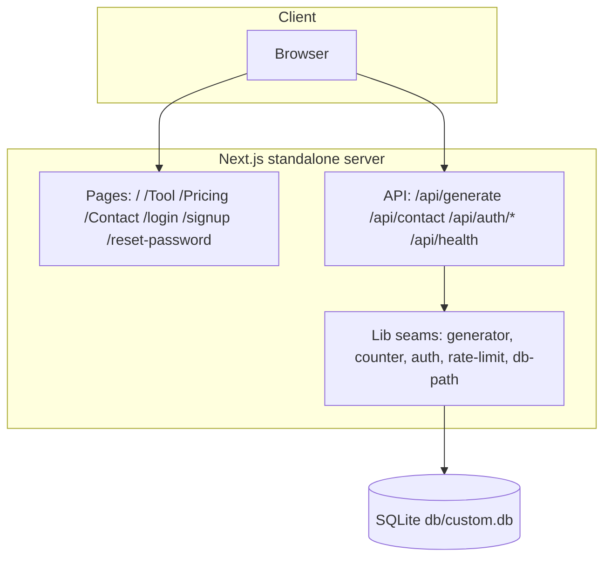

# ViralPost AI

[](https://nextjs.org/)
[](https://react.dev/)
[](https://www.typescriptlang.org/)
[](https://tailwindcss.com/)
[](https://www.prisma.io/)
[](#testing)
[](#license)

A complete, self-hostable clone of
[`viralpostai.base44.app`](https://viralpostai.base44.app/) — the AI social
media post generator — built as a single Next.js application. It is a
**functional superset** of the reference (the generator actually works, the
contact form actually persists, unknown routes answer a true 404) while
holding **visual parity** (class-for-class pages, the WebGL hero, the
particle title, the mobile menu).

## Overview

The reference app sells one thing: describe a post idea, get a
viral-ready social media post. This clone reproduces the whole product —
marketing landing, generator tool, pricing, contact, and the auth funnel —
on a self-hostable stack, and fixes the reference's own defects where it
found them (see [Deviations from the reference](#deviations-from-the-reference)).

## Key features

| Feature | What it does |
|---|---|
| ✨ AI post generator | Deterministic viral-formula engine (hook → 1-2 sentence paragraphs → 5-8 hashtags, < 200 words) — works offline, no API key needed |
| 📊 Free quota | 3 free generations/day with teal fill-dots UI, daily reset, a paywall swap at the limit — plus a server-side IP rate limit the reference lacks |
| 📋 Copy round-trip | One-click copy of the generated post with a Copied! state |
| 🔐 Auth funnel | Email/password signup with verification, login, logout, forgot/reset password — scrypt hashes, HMAC-signed httpOnly cookies, tokenVersion revocation |
| ✉️ Contact form | Persists messages to SQLite (the reference's form is a client-side stub) |
| 🌊 WebGL hero | Iridescence background shader + canvas particle title (4 cycling phrases) — the reference's signature hero, rebuilt dependency-free |
| 📱 Mobile menu | The reference's working dropdown menu, plus Escape/route-change close and readable panels on light pages |
| 🚫 True 404s | Unknown routes answer HTTP 404 with the reference's designed page and its derived `<Route> | ViralPost AI` title (the reference's SPA answers 200 for everything) |
| 🔎 SEO | Per-route metadata, sitemap.xml, robots.txt, PWA manifest, OG/Twitter cards |

## Architecture

One deployable unit: a Next.js App Router application + a SQLite file.
`next build` produces a standalone server.

| Layer | Technology | Version | Purpose |
|---|---|---|---|
| Framework | Next.js (App Router, standalone output) | 16.4 | Pages, API route handlers, SSR metadata |
| UI runtime | React | 19.3 | Server components by default; client islands for interactivity |
| Language | TypeScript (strict) | 5.9 | `tsc --noEmit` is a gate — the build is the type gate |
| Styling | Tailwind CSS (CSS-first) | 4.3 | `@theme` literal hex in `globals.css`; no `tailwind.config.js` |
| ORM / DB | Prisma + SQLite | 6.19 | `db/custom.db` at the repo root; PostgreSQL swap documented |
| Validation | Zod | 4.6 | Every API boundary |
| Icons | lucide-react | 0.525 | The reference's own icon family |
| Unit tests | Vitest | 5.0 | 37 files / 528 tests, node env, pure seams |
| E2E | Playwright | 1.64 | 9 specs / 54 tests against the production build |
| A11y | axe-core | 4.x | A11y assertions inside the e2e suite |
| Runtime | Bun | 1.3 | Scripts run from the repo root |



## File hierarchy

```
📂 viralpost-ai/
├── 📂 prisma/                 schema + idempotent seed (demo user)
├── 📂 db/                     SQLite databases (gitignored, .gitkeep'd)
├── 📂 public/                 og-image, hero portrait (screenshots live in docs/)
├── 📂 src/
│   ├── 📂 app/
│   │   ├── 📂 (site)/         landing, Tool, Pricing, Contact (+ shared chrome)
│   │   ├── 📂 [...catchAll]/  the 404: derived title + true status
│   │   ├── 📂 api/            generate, contact, health, auth family
│   │   ├── 📂 login/ signup/ reset-password/
│   │   ├── layout.tsx         root layout, metadata, viewport
│   │   └── globals.css        the Tailwind v4 theme (teal/amber tokens)
│   ├── 📂 components/
│   │   ├── 📂 marketing/      navbar, footer, hero, sections, generator card
│   │   ├── 📂 effects/        iridescence (WebGL), particle-text, reveal
│   │   ├── 📂 layout/         login card, reset-password screen
│   │   └── 📂 ui/             toast
│   └── 📂 lib/                the pure seams (generator, counter, auth,
│                              rate-limit, db-path, site, route-title, …)
├── 📂 tests/                  37 unit suites + 📂 e2e/ (9 Playwright specs)
├── 📂 scripts/                smoke-test.sh, census, prisma-env
├── 📂 docs/                   plans, reference investigation, screenshots
├── 📂 skills/                 the owner's skill catalog (not app code)
└── 📄 AGENTS.md · CLAUDE.md · worklog.md · Project_Architecture_Document.md
```

## Quick start

Requirements: **Bun ≥ 1.3** (or Node ≥ 20), a POSIX shell.

```bash
git clone https://github.com/nordeim/viralpost-ai.git
cd viralpost-ai
bun install
cp .env.example .env           # then set AUTH_SECRET for anything non-dev
bun run db:push                # schema → db/custom.db
bun run db:seed                # idempotent demo data
bun run dev                    # http://localhost:3000
```

**Verify setup:**

```bash
bun run db:census              # → "pristine: MATCH (1 user + 0 contact messages)"
curl -s localhost:3000/api/health   # → {"ok":true,"data":{"status":"healthy",...}}
```

Demo login (mirrors the reference app):
`sepnetflix2023@outlook.com` / `$Abcd1234`.

## Environment variables

| Variable | Required | Purpose |
|---|---|---|
| `DATABASE_URL` | yes | `file:../db/custom.db` (SQLite; resolves against `prisma/schema.prisma`). PostgreSQL example in `.env.example` |
| `AUTH_SECRET` | **production: yes** | HMAC key for session cookies (≥ 16 chars, `openssl rand -hex 32`). Missing/short in production = the server refuses to boot |
| `NEXT_PUBLIC_SITE_URL` | recommended | Canonical origin for metadata/sitemap/robots — inlined at build time, set before `bun run build` |
| `VIRALPOST_PROXY_HOPS` | behind a proxy | Trusted proxy depth for rate-limit IP keying (unset = 1; unparsable fails closed) |
| `VIRALPOST_DISABLE_IN_APP_OTP` | production | Set to `1` when a real mail transport owns verification-code delivery (unset in production prints a boot warning — the code rides the responses) |
| `VIRALPOST_DISABLE_IN_APP_RESET` | production | Set to `1` when a real mail transport owns reset-link delivery (unset in production prints a boot warning — the link rides the response) |

## Testing

```bash
bun run test            # Vitest unit suite (37 files / 528 tests)
bun run test:e2e        # Playwright e2e (9 specs / 54 tests) — needs bun run build first
./scripts/smoke-test.sh # 15-leg curl ladder against the standalone build
bun run gate            # lint + typecheck + unit + build + smoke + e2e, in order
```

The e2e suite boots the **production standalone build** on its own port
with its own scratch database (`db/e2e.db`) — the dev server lies about
production hydration. One setup project signs the demo user in once and
shares the session via `storageState` (per-test logins would trip the auth
rate limiter).

## API reference

| Endpoint | Method | Auth | Description |
|---|---|---|---|
| `/api/generate` | POST | public (IP-limited) | The generator — `{idea}` → `{ok, data:{text}}` |
| `/api/contact` | POST | public | Persist a contact message (Zod-validated) |
| `/api/health` | GET | public | Liveness + db round-trip |
| `/api/auth/signup` | POST | public | Create account, start verification |
| `/api/auth/verify` | POST | public | Verify the email code |
| `/api/auth/resend` | POST | public | Resend the code (own limit) |
| `/api/auth/login` | POST | public | Session cookie |
| `/api/auth/logout` | POST | session | Clear the session |
| `/api/auth/me` | GET | session | The session envelope |
| `/api/auth/forgot-password` | POST | public | No-enumeration reset request |
| `/api/auth/reset-password` | POST | public | Atomic single-use token consume |

All bodies are JSON, validated with Zod, read through a bounded reader
(Content-Type gate + length checks). Responses use the envelope
`{ok, data} | {ok:false, error:{code, message}}`.

## Design system

- **Tokens** (in `src/app/globals.css`, `@theme` with literal hex):
  teal primary (`#14b8a6` family), amber accent (`#f59e0b` family), slate
  neutrals, white surfaces.
- **Type**: the system font stack (the reference ships zero webfonts).
- **Motion**: `Reveal` (IntersectionObserver + CSS transitions,
  `prefers-reduced-motion` aware), the hero's canvas particle cycle and
  WebGL shader; reduced-motion collapses all of it.
- **Layout constants** live in one test-pinned module (`src/lib/page-layout.ts`).

## Deviations from the reference

Recorded in full in `docs/implementation-plan.md` §6. The headline items:

| Area | Reference | Clone | Why |
|---|---|---|---|
| Generator backend | Platform LLM — observed **402-quota-dead**, hangs at "Generating…" forever | Working local engine (a documented provider wire-in point — the exact prompt preserved by `generatorPrompt()`; no provider env is read today) | The core feature must work |
| Unknown routes | SPA answers 200 everywhere; title `startCase(path)` | True 404 status + the same derived title + `noindex` | SEO; the title parity is byte-verified |
| Contact form | Client-side stub, no persistence | Persists to SQLite | The advertised action must be real |
| Auth | localStorage token | httpOnly HMAC cookie + tokenVersion revocation | Security |
| `/Home` | Serves a duplicate of `/` | 308 redirect to `/` | Duplicate content |
| Dead UI | Footer `href="#"` socials | Real platform links | Dead controls are defects |
| Free quota | localStorage only | Same UX + server-side IP rate limit | Abuse resistance |

## Deployment

See [`docs/DEPLOYMENT.md`](docs/DEPLOYMENT.md) — standalone output, the
`AUTH_SECRET` boot gate, the absolute-`DATABASE_URL` recommendation, and
the PostgreSQL swap.

## Project status

| Phase | Status | Delivered |
|---|---|---|
| Session 1 — the clone build | ✅ done | Full app, parity walk, 8 screenshots, first push |
| Session 2 — the parity audit | ✅ done | The `/Dashboard` title decode, env rename, dep diet (−11), docs rebuild, the SKILL distillation |
| Session 3 — the rename completion | ✅ done | Guard-layer `NEO_*` → `VIRALPOST_*` finish (dual-prefix boot gate, re-armed e2e pins, dead page metadata removed); captures 13/14 |
| Session 4 — the phantom-reference audit | ✅ done | CRM-era commentary sweep (typography contract, vitest surface, e2e-port shape, fixture); dev-server captures 15/16 |
| Session 5 — the docs-freshness audit | ✅ done | Session-tracking surfaces synced (SKILL round history, status tables, plans map); DEPLOYMENT env table gained the `VIRALPOST_*` knobs; captures 17/18 |
| Session 6 — the clean-tree re-certification | ✅ done | Widened fresh-eyes audit (secondary docs, scripts, configs): zero findings; parity re-verified live; captures 19/20 |
| Session 7 — the dev-script loop + phantom comments | ✅ done | The `dev` tee reload loop cured (A/B-verified, pinned); api.ts dead helpers retired; phantom CRM claims re-attributed (site.ts, not-found, 405/141→170); captures 21/22 |
| Session 8 — the live OG parity + evidence provenance | ✅ done | The reference's per-route OG family discovered live (D-4 superseded) — the prefixed OG description retired to the plain paragraph (TDD, pinned); the 2026-10-01 phantom-census claims re-attributed (verify funnel, headers census, SEO routes, typography); README badge 450→455; captures 23/24 |
| Session 9 — the rate-limiter trust warning + the docs-counts gate | ✅ done | The unset-`VIRALPOST_PROXY_HOPS` production boot warning (the direct-exposure XFF-rotation hazard); the signup `"rep"` role relic → the schema's `"user"`; the reset funnel's read-path outage honesty (503, never a bare 500); the property suite landed (fast-check over the generator + limiter contracts — the PAD claim made true); contact/generate joined the sweep family; the dead-code + phantom-provider retirement; DEPLOYMENT.md rewritten for ViralPost AI (was ORBITAL-era); the neo-crm docs-counts gate adopted (badge 490 = 442+48, unit-pinned); captures 25/26 |
| Session 10 — the dev-origin hydration lock + the palette re-pin completion | ✅ done | The dev server at `127.0.0.1` never hydrated (Next 16 blocks the loopback origin's HMR socket → the mobile menu and every client island inert — live root-caused) — `allowedDevOrigins` cured it (pinned + live A/B); the v3 palette re-pin completed (11 unpinned steps, green-700 visibly drifted) + the mechanical color-census pin; the malformed-`NEXT_PUBLIC_SITE_URL` brick cured (fallback + boot warning); history-navigation menu close (e2e-pinned); the hashtag window exercised (5-7); CTAs → Link; NOT_FOUND_LAYOUT pinned; CRM-lineage test headers re-attributed; the three straggler count sites pinned; badge 512 = 463+49; captures 27/28 |
| Session 11 — the standalone-launch DB re-anchor + the dead-CSS retirement + the verification-funnel closure | ✅ done | `bun run start` with the default relative `.env` could not open the database (bun's absolutization + the session-7 hygiene step had silently killed the session-34 launch-dir recovery — live root-caused; the neo-crm session-212 hoist cured it, TDD + live A/B); the dead-CSS retirement (the vendored tw-animate.css + 13 dead `@theme` tokens + the dead keyframes/utilities — all phantom-justified) + the step-less color census (`border-input` compiled to nothing) + the dead-token census; the verification funnel closed (enforceable login gate on the stored hash, resend re-mints for expired codes, the 403 re-enters the verify view — full-funnel e2e); the signup P2002 race → 400; the over-length idea message; the menu a11y increments (aria-controls + Escape focus return); the OTP paste distribution; the gate-script + doctrine/inventory censuses adopted from neo-crm; badge 538 = 488+50; captures 29/30 |
| Session 12 — the count-reality census + the reset-funnel e2e + the UX-boundary batch | ✅ done | The count constants pinned to the LIVE SUITES ON DISK (the reality census — constants vs reality, not constants vs docs; the a11y matrix extracted so the loop expansion is computed, not assumed); the password-reset funnel's FIRST behavioral e2e (signup → verify → forgot → the in-app link → new password → session → the single-use replay → 400 — the sibling of session-11's verification-funnel e2e); the UX-boundary batch (the 403 re-entry clears the stale demo-code hint, the verify submit honors `from_url`, the OTP paste takes the trailing six digits via the new `otp.ts` seam, the expired-code 400 answers "no longer valid" not "too many attempts"); the effects hygiene (the reduced-motion branch schedules by timeout — no 60 fps rAF redraw loop; the hero re-reads `devicePixelRatio` per resize); the stepped-semantic census arm; the Logo → Link; the dead-export retirement (ERR.FORBIDDEN/NOT_FOUND, the generateVerifyCode re-export); the PAD's stale tw-animate references retired + the semantic-prose census starter + the one-owner doctrine from neo-crm; badge 559 = 507+52; captures 31/32 |

| Session 13 — the in-app-delivery polarity warning + the OTP log gate + the from_url seam | ✅ done | The delivery-polarity boot warning (production + an unset `VIRALPOST_DISABLE_IN_APP_OTP`/`_RESET` now warns — the live-token-in-response hazard, the unset-hops precedent extended); the OTP log line rides the delivery gate (a mail-transport deployment stops writing codes to stdout); the from_url resolver extracted to the pure seam `src/lib/from-url.ts` (the open-redirect guard's FIRST behavioral coverage: 8 unit pins + 2 e2e legs — the `/Tool` round-trip and the foreign-origin fallback, both live-verified); the reduced-motion phrase cadence cured (advance-then-draw — each phrase exactly one window); the verify route's P2025 → 400 mapping; the font-family hoist out of both fit loops; the census forms-guard (no `.each(`/`.skip(`/`.only(` shapes the count regex cannot see); badge 582 = 528+54; captures 33/34 |

Gate at the session-13 ship: lint 0/0 · tsc 0 · unit 528/528 · build ·
smoke 15/15 · e2e 54/54.

## License

[MIT](LICENSE) — the scaffold's original license carries over.
