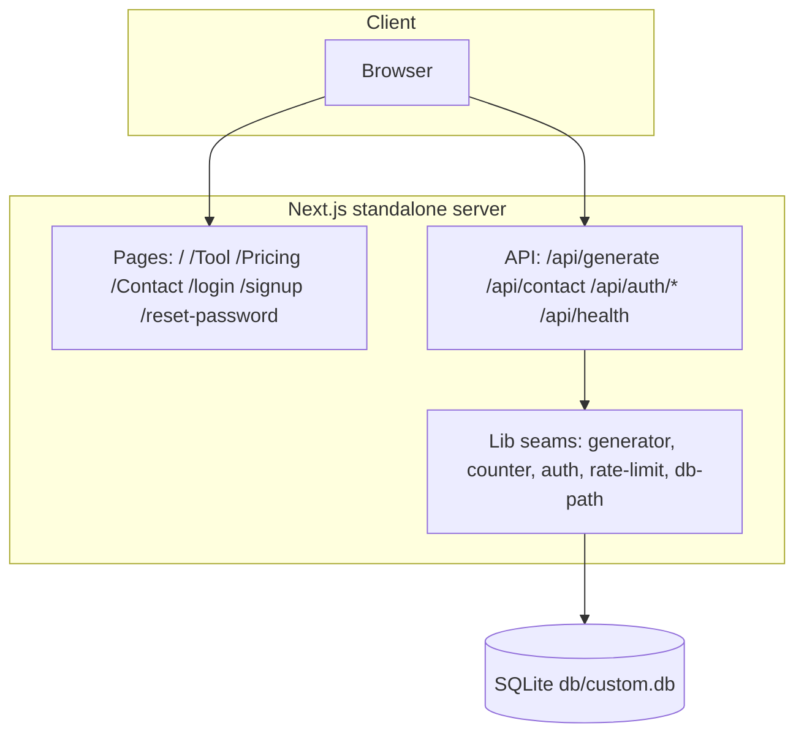

# ViralPost AI

[](https://nextjs.org/)
[](https://react.dev/)
[](https://www.typescriptlang.org/)
[](https://tailwindcss.com/)
[](https://www.prisma.io/)
[](#testing)
[](#license)

A complete, self-hostable clone of
[`viralpostai.base44.app`](https://viralpostai.base44.app/) — the AI social
media post generator — built as a single Next.js application. It is a
**functional superset** of the reference (the generator actually works, the
contact form actually persists, unknown routes answer a true 404) while
holding **visual parity** (class-for-class pages, the WebGL hero, the
particle title, the mobile menu).

## Overview

The reference app sells one thing: describe a post idea, get a
viral-ready social media post. This clone reproduces the whole product —
marketing landing, generator tool, pricing, contact, and the auth funnel —
on a self-hostable stack, and fixes the reference's own defects where it
found them (see [Deviations from the reference](#deviations-from-the-reference)).

## Key features

| Feature | What it does |
|---|---|
| ✨ AI post generator | Deterministic viral-formula engine (hook → 1-2 sentence paragraphs → 5-8 hashtags, < 200 words) — works offline, no API key needed |
| 📊 Free quota | 3 free generations/day with teal fill-dots UI, daily reset, a paywall swap at the limit — plus a server-side IP rate limit the reference lacks |
| 📋 Copy round-trip | One-click copy of the generated post with a Copied! state |
| 🔐 Auth funnel | Email/password signup with verification, login, logout, forgot/reset password — scrypt hashes, HMAC-signed httpOnly cookies, tokenVersion revocation |
| ✉️ Contact form | Persists messages to SQLite (the reference's form is a client-side stub) |
| 🌊 WebGL hero | Iridescence background shader + canvas particle title (4 cycling phrases) — the reference's signature hero, rebuilt dependency-free |
| 📱 Mobile menu | The reference's working dropdown menu, plus Escape/route-change close and readable panels on light pages |
| 🚫 True 404s | Unknown routes answer HTTP 404 with the reference's designed page and its derived `<Route> | ViralPost AI` title (the reference's SPA answers 200 for everything) |
| 🔎 SEO | Per-route metadata, sitemap.xml, robots.txt, PWA manifest, OG/Twitter cards |

## Architecture

One deployable unit: a Next.js App Router application + a SQLite file.
`next build` produces a standalone server.

| Layer | Technology | Version | Purpose |
|---|---|---|---|
| Framework | Next.js (App Router, standalone output) | 16.4 | Pages, API route handlers, SSR metadata |
| UI runtime | React | 19.3 | Server components by default; client islands for interactivity |
| Language | TypeScript (strict) | 5.9 | `tsc --noEmit` is a gate — the build is the type gate |
| Styling | Tailwind CSS (CSS-first) | 4.3 | `@theme` literal hex in `globals.css`; no `tailwind.config.js` |
| ORM / DB | Prisma + SQLite | 6.19 | `db/custom.db` at the repo root; PostgreSQL swap documented |
| Validation | Zod | 4.6 | Every API boundary |
| Icons | lucide-react | 0.525 | The reference's own icon family |
| Unit tests | Vitest | 5.0 | 29 files / 405 tests, node env, pure seams |
| E2E | Playwright | 1.64 | 8 specs / 48 tests against the production build |
| A11y | axe-core | 4.x | A11y assertions inside the e2e suite |
| Runtime | Bun | 1.3 | Scripts run from the repo root |



## File hierarchy

```
📂 viralpost-ai/
├── 📂 prisma/                 schema + idempotent seed (demo user)
├── 📂 db/                     SQLite databases (gitignored, .gitkeep'd)
├── 📂 public/                 og-image, portrait, screenshots
├── 📂 src/
│   ├── 📂 app/
│   │   ├── 📂 (site)/         landing, Tool, Pricing, Contact (+ shared chrome)
│   │   ├── 📂 [...catchAll]/  the 404: derived title + true status
│   │   ├── 📂 api/            generate, contact, health, auth family
│   │   ├── 📂 login/ signup/ reset-password/
│   │   ├── layout.tsx         root layout, metadata, viewport
│   │   └── globals.css        the Tailwind v4 theme (teal/amber tokens)
│   ├── 📂 components/
│   │   ├── 📂 marketing/      navbar, footer, hero, sections, generator card
│   │   ├── 📂 effects/        iridescence (WebGL), particle-text, reveal
│   │   ├── 📂 layout/         login card, reset-password screen
│   │   └── 📂 ui/             toast
│   └── 📂 lib/                the pure seams (generator, counter, auth,
│                              rate-limit, db-path, site, route-title, …)
├── 📂 tests/                  29 unit suites + 📂 e2e/ (8 Playwright specs)
├── 📂 scripts/                smoke-test.sh, census, prisma-env
├── 📂 docs/                   plans, reference investigation, screenshots
├── 📂 skills/                 the owner's skill catalog (not app code)
└── 📄 AGENTS.md · CLAUDE.md · worklog.md · Project_Architecture_Document.md
```

## Quick start

Requirements: **Bun ≥ 1.3** (or Node ≥ 20), a POSIX shell.

```bash
git clone https://github.com/nordeim/viralpost-ai.git
cd viralpost-ai
bun install
cp .env.example .env           # then set AUTH_SECRET for anything non-dev
bun run db:push                # schema → db/custom.db
bun run db:seed                # idempotent demo data
bun run dev                    # http://localhost:3000
```

**Verify setup:**

```bash
bun run db:census              # → "pristine: MATCH (1 user + 0 contact messages)"
curl -s localhost:3000/api/health   # → {"ok":true,"data":{"status":"healthy",...}}
```

Demo login (mirrors the reference app):
`sepnetflix2023@outlook.com` / `$Abcd1234`.

## Environment variables

| Variable | Required | Purpose |
|---|---|---|
| `DATABASE_URL` | yes | `file:../db/custom.db` (SQLite; resolves against `prisma/schema.prisma`). PostgreSQL example in `.env.example` |
| `AUTH_SECRET` | **production: yes** | HMAC key for session cookies (≥ 16 chars, `openssl rand -hex 32`). Missing/short in production = the server refuses to boot |
| `NEXT_PUBLIC_SITE_URL` | recommended | Canonical origin for metadata/sitemap/robots — inlined at build time, set before `bun run build` |
| `VIRALPOST_PROXY_HOPS` | behind a proxy | Trusted proxy depth for rate-limit IP keying (unset = 1; unparsable fails closed) |
| `VIRALPOST_DISABLE_IN_APP_OTP` | production | Set to `1` when a real mail transport owns verification-code delivery |
| `VIRALPOST_DISABLE_IN_APP_RESET` | production | Set to `1` when a real mail transport owns reset-link delivery |

## Testing

```bash
bun run test            # Vitest unit suite (29 files / 405 tests)
bun run test:e2e        # Playwright e2e (8 specs / 48 tests) — needs bun run build first
./scripts/smoke-test.sh # 15-leg curl ladder against the standalone build
bun run gate            # lint + typecheck + unit + build + smoke + e2e, in order
```

The e2e suite boots the **production standalone build** on its own port
with its own scratch database (`db/e2e.db`) — the dev server lies about
production hydration. One setup project signs the demo user in once and
shares the session via `storageState` (per-test logins would trip the auth
rate limiter).

## API reference

| Endpoint | Method | Auth | Description |
|---|---|---|---|
| `/api/generate` | POST | public (IP-limited) | The generator — `{idea}` → `{ok, data:{text}}` |
| `/api/contact` | POST | public | Persist a contact message (Zod-validated) |
| `/api/health` | GET | public | Liveness + db round-trip |
| `/api/auth/signup` | POST | public | Create account, start verification |
| `/api/auth/verify` | POST | public | Verify the email code |
| `/api/auth/resend` | POST | public | Resend the code (own limit) |
| `/api/auth/login` | POST | public | Session cookie |
| `/api/auth/logout` | POST | session | Clear the session |
| `/api/auth/me` | GET | session | The session envelope |
| `/api/auth/forgot-password` | POST | public | No-enumeration reset request |
| `/api/auth/reset-password` | POST | public | Atomic single-use token consume |

All bodies are JSON, validated with Zod, read through a bounded reader
(Content-Type gate + length checks). Responses use the envelope
`{ok, data} | {ok:false, error:{code, message}}`.

## Design system

- **Tokens** (in `src/app/globals.css`, `@theme inline` with literal hex):
  teal primary (`#14b8a6` family), amber accent (`#f59e0b` family), slate
  neutrals, white surfaces.
- **Type**: the system font stack (the reference ships zero webfonts).
- **Motion**: `Reveal` (IntersectionObserver + CSS transitions,
  `prefers-reduced-motion` aware), the hero's canvas particle cycle and
  WebGL shader; reduced-motion collapses all of it.
- **Layout constants** live in one test-pinned module (`src/lib/page-layout.ts`).

## Deviations from the reference

Recorded in full in `docs/implementation-plan.md` §6. The headline items:

| Area | Reference | Clone | Why |
|---|---|---|---|
| Generator backend | Platform LLM — observed **402-quota-dead**, hangs at "Generating…" forever | Working local engine + optional env-keyed provider | The core feature must work |
| Unknown routes | SPA answers 200 everywhere; title `startCase(path)` | True 404 status + the same derived title + `noindex` | SEO; the title parity is byte-verified |
| Contact form | Client-side stub, no persistence | Persists to SQLite | The advertised action must be real |
| Auth | localStorage token | httpOnly HMAC cookie + tokenVersion revocation | Security |
| `/Home` | Serves a duplicate of `/` | 308 redirect to `/` | Duplicate content |
| Dead UI | Footer `href="#"` socials | Real platform links | Dead controls are defects |
| Free quota | localStorage only | Same UX + server-side IP rate limit | Abuse resistance |

## Deployment

See [`docs/DEPLOYMENT.md`](docs/DEPLOYMENT.md) — standalone output, the
`AUTH_SECRET` boot gate, the absolute-`DATABASE_URL` recommendation, and
the PostgreSQL swap.

## Project status

| Phase | Status | Delivered |
|---|---|---|
| Session 1 — the clone build | ✅ done | Full app, parity walk, 8 screenshots, first push |
| Session 2 — the parity audit | ✅ done | The `/Dashboard` title decode, env rename, dep diet (−11), docs rebuild, the SKILL distillation |

Gate at the session-3 ship: lint 0/0 · tsc 0 · unit 405/405 · build ·
smoke 15/15 · e2e 48/48.

## License

[MIT](LICENSE) — the scaffold's original license carries over.
